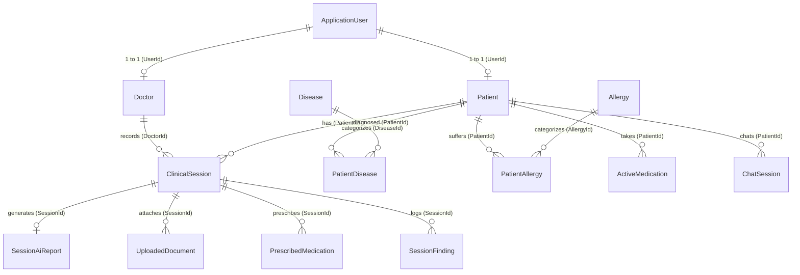
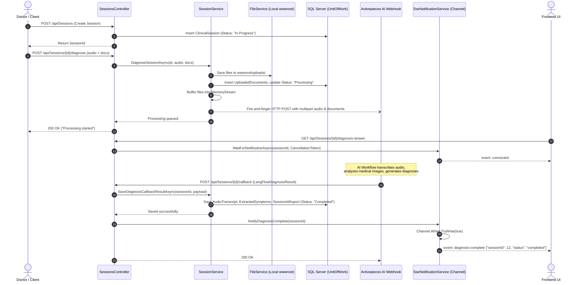
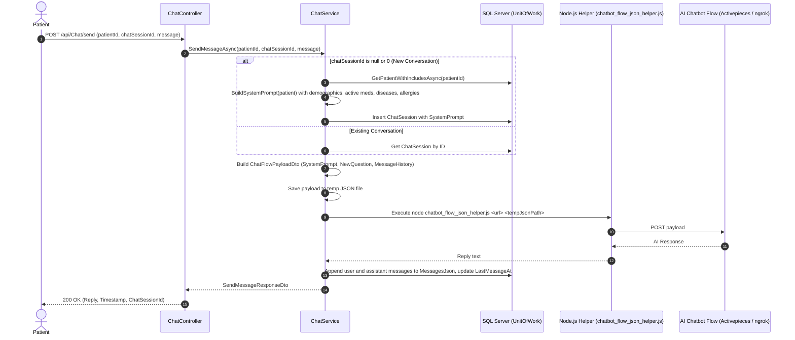

# CliniKa Backend Technical Documentation

---

## 1. Project Overview & Architecture

CliniKa is an enterprise healthcare backend system built with **.NET 10 (C# 14)** using **Clean Architecture** (Separation of Concerns across Domain, Application, Infrastructure, and Presentation layers). The system provides electronic medical record management, role-based identity management, clinical session recording and AI-driven multi-modal diagnostic assistance, drug interaction checks, real-time Server-Sent Events (SSE) diagnostic notifications, and an AI-powered medical assistant chatbot.

### 1.1 Architectural Layers

```text
               ┌─────────────────────────────────────────┐
               │         CliniKa.Presentation            │
               │   (ASP.NET Core Web API, Controllers,   │
               │    Middlewares, Swagger, DI Setup)      │
               └────────────────────┬────────────────────┘
                                    │
                                    ▼
               ┌─────────────────────────────────────────┐
               │          CliniKa.Application            │
               │     (Service Interfaces, DTOs,          │
               │   FluentValidation, Mapster, Wrappers)  │
               └─────────┬─────────────────────┬─────────┘
                         │                     │
                         ▼                     │
               ┌───────────────────┐           │
               │  CliniKa.Domain   │◄──────────┘
               │  (Entities, Core  │
               │   Repository Int.)│
               └───────────────────┘
                         ▲
                         │
               ┌─────────────────────────────────────────┐
               │        CliniKa.Infrastructure           │
               │ (EF Core AppDbContext, Repositories,    │
               │  ASP.NET Identity, JWT, SendGrid,       │
               │  Activepieces/LangFlow, SSE Channels)   │
               └─────────────────────────────────────────┘
```

#### Layer Responsibilities

| Project | Responsibility | Key Dependencies |
| :--- | :--- | :--- |
| **`CliniKa.Domain`** | Core enterprise domain entities and repository contract interfaces. Has zero external dependencies. | *.NET 10 Base Class Library* |
| **`CliniKa.Application`** | Application business abstractions, DTO models, FluentValidation request validators, Mapster object mapping, and response wrappers (`GeneralResult`). | `CliniKa.Domain`, `FluentValidation.AspNetCore`, `Mapster`, `Microsoft.EntityFrameworkCore.Design` |
| **`CliniKa.Infrastructure`** | Persistence (`AppDbContext`, entity type configurations, migrations, data seeders), Generic Repository and Unit of Work implementations, ASP.NET Core Identity integration, JWT token provider, SendGrid email client, external webhook dispatchers, file storage service, and SSE thread-safe channel coordination. | `CliniKa.Application`, `CliniKa.Domain`, `Microsoft.EntityFrameworkCore.SqlServer`, `Microsoft.AspNetCore.Identity.EntityFrameworkCore`, `Microsoft.AspNetCore.Authentication.JwtBearer`, `SendGrid`, `System.Linq.Dynamic.Core` |
| **`CliniKa.Presentation`** | REST API Controllers, global exception handling middleware (`IExceptionHandler`), CORS policies, Swagger/OpenAPI JWT configuration, and application bootstrapping (`Program.cs`). | `CliniKa.Application`, `CliniKa.Infrastructure`, `Swashbuckle.AspNetCore`, `Serilog.Extensions.Logging.File` |

---

## 2. Project Structure

```text
CliniKa/
│
├── CliniKa.sln
│
├── CliniKa.Domain/
│   ├── CliniKa.Domain.csproj
│   ├── Entities/
│   │   ├── ActiveMedication.cs
│   │   ├── Allergy.cs
│   │   ├── ChatSession.cs
│   │   ├── ClinicalSession.cs
│   │   ├── Disease.cs
│   │   ├── Doctor.cs
│   │   ├── Patient.cs
│   │   ├── PatientAllergy.cs
│   │   ├── PatientDisease.cs
│   │   ├── PrescribedMedication.cs
│   │   ├── SessionAiReport.cs
│   │   ├── SessionFinding.cs
│   │   └── UploadedDocument.cs
│   └── Repositories/
│       ├── IActiveMedicationsRepository.cs
│       ├── IAllergyRepository.cs
│       ├── IChatSessionRepository.cs
│       ├── IClinicalSessionRepository.cs
│       ├── IDiseaseRepository.cs
│       ├── IDoctorRepository.cs
│       ├── IGenericRepository.cs
│       ├── IPatientRepository.cs
│       ├── IPrescribedMedicationsRepository.cs
│       ├── ISessionAIReportsRepository.cs
│       └── IUnitOfWork.cs
│
├── CliniKa.Application/
│   ├── CliniKa.Application.csproj
│   ├── Abstractions/
│   │   ├── Authentication/
│   │   │   ├── IAuthService.cs
│   │   │   ├── ICurrentUserService.cs
│   │   │   └── IJwtProvider.cs
│   │   └── Services/
│   │       ├── IAllergyService.cs
│   │       ├── IChatService.cs
│   │       ├── IDiagnosisNotificationService.cs
│   │       ├── IDiseaseService.cs
│   │       ├── IEmailSender.cs
│   │       ├── IFileService.cs
│   │       ├── ILangFlowService.cs
│   │       ├── IPatientService.cs
│   │       ├── IRoleService.cs
│   │       ├── ISessionService.cs
│   │       └── IUserService.cs
│   ├── Constants/
│   │   └── RoleConstants.cs
│   ├── DTOs/
│   │   ├── Allergy/
│   │   │   ├── AllergyResponseDto.cs
│   │   │   ├── CreateAllergyRequest.cs
│   │   │   └── UpdateAllergyRequest.cs
│   │   ├── Authentication/
│   │   │   ├── ConfirmEmailDto.cs
│   │   │   ├── ForgetPasswordRequest.cs
│   │   │   ├── LoginDto.cs
│   │   │   ├── RegisterDto.cs
│   │   │   └── ResetPasswordRequest.cs
│   │   ├── Chat/
│   │   │   └── ChatDtos.cs
│   │   ├── Disease/
│   │   │   ├── CreateDiseaseRequest.cs
│   │   │   ├── DiseaseResponseDto.cs
│   │   │   └── UpdateDiseaseRequest.cs
│   │   ├── FormFile/
│   │   │   └── UploadFileRequest.cs
│   │   ├── Langflow/
│   │   │   └── LangFlowDiagnosisResult.cs
│   │   ├── Patient/
│   │   │   ├── AddAllergyRequest.cs
│   │   │   ├── AddDiseaseRequest.cs
│   │   │   ├── AddMedicalInfoRequest.cs
│   │   │   ├── AddMedicationRequest.cs
│   │   │   ├── AllergyDto.cs
│   │   │   ├── ConflictMedicationDto.cs
│   │   │   ├── DiseaseDto.cs
│   │   │   ├── MedicationDto.cs
│   │   │   ├── PatientHistoryReadDto.cs
│   │   │   ├── PatientMedicalDataDto.cs
│   │   │   ├── PatientProfileDto.cs
│   │   │   ├── PatientReadDTO.cs
│   │   │   ├── PatientSessionDetailsDto.cs
│   │   │   ├── PatientSessionDto.cs
│   │   │   ├── PrescribedMedicationDto.cs
│   │   │   ├── SessionAiReportDto.cs
│   │   │   └── UploadedDocumentDto.cs
│   │   ├── Role/
│   │   │   ├── CreateRoleRequest.cs
│   │   │   └── RoleDto.cs
│   │   ├── Sessions/
│   │   │   ├── DiagnoseSessionResponseDto.cs
│   │   │   ├── SessionDto.cs
│   │   │   └── WorkflowSessionPayloadDto.cs
│   │   └── User/
│   │       ├── CreateUserRequest.cs
│   │       └── UserDto.cs
│   ├── Extensions/
│   │   └── ApplicationExtensionServices.cs
│   ├── Services/
│   │   ├── AllergyService.cs
│   │   ├── DiseaseService.cs
│   │   ├── PatientService.cs
│   │   └── SessionService.cs
│   ├── Validators/
│   │   ├── AddAllergyRequestValidator.cs
│   │   ├── AddDiseaseRequestValidator.cs
│   │   ├── AddMedicalInfoRequestValidator.cs
│   │   ├── AddMedicationRequestValidator.cs
│   │   ├── ConfirmEmailValidator.cs
│   │   ├── CreateAllergyRequestValidator.cs
│   │   ├── CreateDiseaseRequestValidator.cs
│   │   ├── CreateRoleRequestValidator.cs
│   │   ├── CreateUserRequestValidator.cs
│   │   ├── ForgetPasswordRequestValidator.cs
│   │   ├── LoginRequestValidator.cs
│   │   ├── RegisterRequestValidator.cs
│   │   ├── ResetPasswordRequestValidator.cs
│   │   ├── UpdateAllergyRequestValidator.cs
│   │   └── UpdateDiseaseRequestValidator.cs
│   └── Wrappers/
│       ├── GeneralResult.cs
│       └── ResultStatus.cs
│
├── CliniKa.Infrastructure/
│   ├── CliniKa.Infrastructure.csproj
│   ├── Authentication/
│   │   └── JwtProvider.cs
│   ├── Extensions/
│   │   └── InfrastructureExtensions.cs
│   ├── Options/
│   │   ├── JwtOptions.cs
│   │   └── SendGridOptions.cs
│   ├── Persistence/
│   │   ├── Configurations/
│   │   │   ├── ActiveMedicationConfiguration.cs
│   │   │   ├── AllergyConfiguration.cs
│   │   │   ├── ApplicationUserConfiguration.cs
│   │   │   ├── ChatSessionConfiguration.cs
│   │   │   ├── ClinicalSessionConfiguration.cs
│   │   │   ├── DiseaseConfiguration.cs
│   │   │   ├── DoctorConfiguration.cs
│   │   │   ├── PatientAllergyConfiguration.cs
│   │   │   ├── PatientConfiguration.cs
│   │   │   ├── PatientDiseaseConfiguration.cs
│   │   │   ├── PrescribedMedicationConfiguration.cs
│   │   │   ├── SessionAiReportConfiguration.cs
│   │   │   ├── SessionFindingConfiguration.cs
│   │   │   └── UploadedDocumentConfiguration.cs
│   │   ├── Context/
│   │   │   └── AppDbContext.cs
│   │   ├── Identity/
│   │   │   ├── ApplicationRole.cs
│   │   │   └── ApplicationUser.cs
│   │   ├── Migrations/
│   │   └── Seeders/
│   │       └── RoleAndUserSeeder.cs
│   ├── Repositories/
│   │   ├── ActiveMedicationsRepository.cs
│   │   ├── AllergyRepository.cs
│   │   ├── ChatSessionRepository.cs
│   │   ├── ClinicalSessionRepository.cs
│   │   ├── DiseaseRepository.cs
│   │   ├── DoctorRepository.cs
│   │   ├── GenericRepository.cs
│   │   ├── PatientRepository.cs
│   │   ├── PrescribedMedicationsRepository.cs
│   │   ├── SessionAIReportsRepository.cs
│   │   └── UnitOfWork.cs
│   └── Services/
│       ├── AuthService.cs
│       ├── ChatService.cs
│       ├── CurrentUserService.cs
│       ├── FileService.cs
│       ├── LangFlowService.cs
│       ├── RoleService.cs
│       ├── SendGridEmailSender.cs
│       ├── SseNotificationService.cs
│       └── UserService.cs
│
├── CliniKa.Presentation/
│   ├── CliniKa.Presentation.csproj
│   ├── Program.cs
│   ├── activepieces_helper.js
│   ├── chatbot_flow_json_helper.js
│   ├── langflow_helper.js
│   ├── langflow_trigger_interaction_json_helper.js
│   ├── appsettings.json
│   ├── appsettings.Development.json
│   ├── Controllers/
│   │   ├── ActivePiecesTestController.cs
│   │   ├── AllergiesController.cs
│   │   ├── AuthController.cs
│   │   ├── ChatController.cs
│   │   ├── DiseasesController.cs
│   │   ├── FileController.cs
│   │   ├── PatientController.cs
│   │   ├── RolesController.cs
│   │   ├── SessionsController.cs
│   │   └── UsersController.cs
│   ├── Extensions/
│   │   └── PresentaionServiceExtensions.cs
│   ├── Middlewares/
│   │   └── GlobalExceptionHandler.cs
│   ├── Options/
│   │   └── JwtOptions.cs
│   └── wwwroot/
│       └── uploads/
│
└── CliniKa.Tests/
    ├── CliniKa.Tests.csproj
    └── PatientServiceTests.cs
```

---

## 3. Database Architecture & Entity Framework Core

The database is built on **Microsoft SQL Server** managed via **Entity Framework Core 10**.

### 3.1 Database Context (`AppDbContext`)

`AppDbContext` inherits from `IdentityDbContext<ApplicationUser, ApplicationRole, string>` and registers 13 domain entity `DbSet` collections:

1. `Doctors` (`DbSet<Doctor>`)
2. `Patients` (`DbSet<Patient>`)
3. `ClinicalSessions` (`DbSet<ClinicalSession>`)
4. `SessionAIReports` (`DbSet<SessionAiReport>`)
5. `UploadedDocuments` (`DbSet<UploadedDocument>`)
6. `Diseases` (`DbSet<Disease>`)
7. `PatientDiseases` (`DbSet<PatientDisease>`)
8. `Allergies` (`DbSet<Allergy>`)
9. `PatientAllergies` (`DbSet<PatientAllergy>`)
10. `ActiveMedications` (`DbSet<ActiveMedication>`)
11. `PrescribedMedications` (`DbSet<PrescribedMedication>`)
12. `SessionFindings` (`DbSet<SessionFinding>`)
13. `ChatSessions` (`DbSet<ChatSession>`)

---

### 3.2 Domain Entities & Schema Details



#### Entity Definitions

##### 1. `ApplicationUser` (Table: `AspNetUsers`)
* **PK**: `Id` (`nvarchar(450)`)
* **Properties**: `FirstName` (`nvarchar(100)`, Required), `LastName` (`nvarchar(100)`, Required), `IsActive` (`bit`, Default: `true`), plus standard ASP.NET Identity properties (`Email`, `UserName`, `PasswordHash`, `PhoneNumber`, `EmailConfirmed`, etc.).
* **Navigations**: `Doctor?`, `Patient?`.

##### 2. `ApplicationRole` (Table: `AspNetRoles`)
* **PK**: `Id` (`nvarchar(450)`)
* **Properties**: `Name`, `NormalizedName`, `RoleDescription` (`nvarchar(max)`).

##### 3. `Doctor` (Table: `Doctors`)
* **PK**: `Id` (`int`, Identity)
* **Properties**:
  * `FullName` (`nvarchar(100)`, Required)
  * `CreatedAt` (`datetime2`, Default: `GETDATE()`)
  * `UserId` (`nvarchar(450)`, Required, Unique Index `IX_Doctors_UserId`)
* **Relationships**:
  * 1-to-1 with `ApplicationUser` via `UserId` (`OnDelete: Cascade`)
  * 1-to-Many with `ClinicalSession`

##### 4. `Patient` (Table: `Patients`)
* **PK**: `Id` (`int`, Identity)
* **Properties**:
  * `FullName` (`nvarchar(100)`, Required, Index: `idx_patients_name`)
  * `DateOfBirth` (`DATE`, Nullable)
  * `Gender` (`nvarchar(10)`, Nullable)
  * `BloodType` (`nvarchar(5)`, Nullable)
  * `NationalId` (`nvarchar(20)`, Nullable, Unique Index: `idx_patients_national_id`)
  * `CreatedAt` (`datetime2`, Default: `GETDATE()`)
  * `CompletedAt` (`datetime2`, Nullable)
  * `UserId` (`nvarchar(450)`, Required, Unique Index: `IX_Patients_UserId`)
* **Relationships**:
  * 1-to-1 with `ApplicationUser` via `UserId` (`OnDelete: Cascade`)
  * 1-to-Many with `ClinicalSession`, `PatientDisease`, `PatientAllergy`, `ActiveMedication`, `ChatSession`

##### 5. `ClinicalSession` (Table: `ClinicalSessions`)
* **PK**: `Id` (`int`, Identity)
* **Properties**:
  * `PatientId` (`int`, Required)
  * `DoctorId` (`int`, Required)
  * `VisitDate` (`datetime2`, Required, Default: `GETDATE()`)
  * `AudioTranscript` (`nvarchar(max)`, Nullable)
  * `ExtractedSymptoms` (`nvarchar(max)`, Nullable)
  * `MentionedMedications` (`nvarchar(max)`, Nullable)
  * `MentionedHistory` (`nvarchar(max)`, Nullable)
  * `FinalDiagnosis` (`nvarchar(500)`, Nullable)
  * `DoctorNotes` (`nvarchar(max)`, Nullable)
  * `FollowUpRecommendations` (`nvarchar(max)`, Nullable)
  * `Status` (`nvarchar(20)`, Required, Default: `"In Progress"`)
  * `FinalizedAt` (`datetime2`, Nullable)
* **Indexes**: Composite Index `idx_sessions_patient_date` (`PatientId` ASC, `VisitDate` DESC)
* **Relationships**:
  * Belongs to `Patient` (`OnDelete: Cascade`)
  * Belongs to `Doctor` (`OnDelete: Restrict`)
  * 1-to-1 with `SessionAiReport`
  * 1-to-Many with `UploadedDocument`, `PrescribedMedication`, `SessionFinding`, `PatientDisease`, `PatientAllergy`, `ActiveMedication`

##### 6. `SessionAiReport` (Table: `SessionAIReports`)
* **PK**: `Id` (`int`, Identity)
* **Properties**:
  * `SessionId` (`int`, Required, Unique Index `IX_SessionAIReports_SessionId`)
  * `PatientSummary` (`nvarchar(max)`, Nullable)
  * `PossibleDiagnoses` (`nvarchar(max)`, Nullable)
  * `DrugInteractions` (`nvarchar(max)`, Nullable)
  * `Contraindications` (`nvarchar(max)`, Nullable)
  * `SuggestedInvestigations` (`nvarchar(max)`, Nullable)
  * `ClinicalAlerts` (`nvarchar(max)`, Nullable)
  * `GeneratedAt` (`datetime2`, Default: `GETDATE()`)
* **Relationships**: 1-to-1 with `ClinicalSession` (`OnDelete: Cascade`)

##### 7. `UploadedDocument` (Table: `UploadedDocuments`)
* **PK**: `Id` (`int`, Identity)
* **Properties**:
  * `SessionId` (`int`, Required)
  * `DocumentType` (`nvarchar(30)`, Required)
  * `FilePath` (`nvarchar(500)`, Required)
  * `ExtractedText` (`nvarchar(max)`, Nullable)
  * `UploadedAt` (`datetime2`, Default: `GETDATE()`)
* **Relationships**: Belongs to `ClinicalSession` (`OnDelete: Cascade`)

##### 8. `Disease` (Table: `Diseases`)
* **PK**: `Id` (`int`, Identity)
* **Properties**:
  * `DiseaseCode` (`nvarchar(15)`, Required, Unique Index `IX_Diseases_DiseaseCode`)
  * `DiseaseName` (`nvarchar(150)`, Required)
  * `Description` (`nvarchar(max)`, Nullable)
* **Relationships**: 1-to-Many with `PatientDisease`

##### 9. `PatientDisease` (Table: `PatientDiseases`)
* **PK**: `Id` (`int`, Identity)
* **Properties**:
  * `PatientId` (`int`, Required)
  * `DiseaseId` (`int`, Nullable)
  * `RawDiseaseName` (`nvarchar(200)`, Nullable)
  * `DiagnosedDate` (`DATE`, Default: `CAST(GETDATE() AS DATE)`)
  * `SourceSessionId` (`int`, Nullable)
* **Indexes**: `idx_patient_diseases` on `PatientId`
* **Relationships**:
  * Belongs to `Patient` (`OnDelete: Cascade`)
  * Belongs to `Disease` (`OnDelete: Cascade`, optional)
  * Belongs to `ClinicalSession` (`OnDelete: Restrict`, optional)

##### 10. `Allergy` (Table: `Allergies`)
* **PK**: `Id` (`int`, Identity)
* **Properties**:
  * `AllergenName` (`nvarchar(100)`, Required)
  * `AllergyType` (`nvarchar(50)`, Nullable)
* **Relationships**: 1-to-Many with `PatientAllergy`

##### 11. `PatientAllergy` (Table: `PatientAllergies`)
* **PK**: `Id` (`int`, Identity)
* **Properties**:
  * `PatientId` (`int`, Required)
  * `AllergyId` (`int`, Nullable)
  * `RawAllergenName` (`nvarchar(200)`, Nullable)
  * `Severity` (`nvarchar(20)`, Nullable)
  * `SourceSessionId` (`int`, Nullable)
* **Indexes**: `idx_patient_allergies` on `PatientId`
* **Relationships**:
  * Belongs to `Patient` (`OnDelete: Cascade`)
  * Belongs to `Allergy` (`OnDelete: Cascade`, optional)
  * Belongs to `ClinicalSession` (`OnDelete: Restrict`, optional)

##### 12. `ActiveMedication` (Table: `ActiveMedications`)
* **PK**: `Id` (`int`, Identity)
* **Properties**:
  * `PatientId` (`int`, Required)
  * `DrugName` (`nvarchar(100)`, Required)
  * `Dosage` (`nvarchar(50)`, Nullable)
  * `Frequency` (`nvarchar(50)`, Nullable)
  * `StartDate` (`DATE`, Required)
  * `EndDate` (`DATE`, Nullable)
  * `SourceSessionId` (`int`, Nullable)
* **Computed/Ignored Property**: `IsActive` (`EndDate == null || EndDate.Value.Date >= DateTime.UtcNow.Date`)
* **Indexes**: `idx_active_meds` on `PatientId`
* **Relationships**:
  * Belongs to `Patient` (`OnDelete: Cascade`)
  * Belongs to `ClinicalSession` (`OnDelete: Restrict`, optional)

##### 13. `PrescribedMedication` (Table: `PrescribedMedications`)
* **PK**: `Id` (`int`, Identity)
* **Properties**:
  * `SessionId` (`int`, Required)
  * `DrugName` (`nvarchar(100)`, Required)
  * `Dosage` (`nvarchar(50)`, Nullable)
  * `Frequency` (`nvarchar(50)`, Nullable)
  * `Duration` (`nvarchar(50)`, Nullable)
  * `Notes` (`nvarchar(500)`, Nullable)
* **Indexes**: `idx_prescribed_session` on `SessionId`
* **Relationships**: Belongs to `ClinicalSession` (`OnDelete: Cascade`)

##### 14. `SessionFinding` (Table: `SessionFindings`)
* **PK**: `Id` (`int`, Identity)
* **Properties**:
  * `SessionId` (`int`, Required)
  * `FindingType` (`nvarchar(50)`, Required)
  * `Description` (`nvarchar(max)`, Required)
  * `Severity` (`nvarchar(20)`, Nullable)
  * `DoctorAction` (`nvarchar(50)`, Default: `"Pending"`)
  * `LoggedAt` (`datetime2`, Default: `GETDATE()`)
* **Indexes**: `idx_findings_session` on `SessionId`
* **Relationships**: Belongs to `ClinicalSession` (`OnDelete: Cascade`)

##### 15. `ChatSession` (Table: `ChatSessions`)
* **PK**: `Id` (`int`, Identity)
* **Properties**:
  * `PatientId` (`int`, Required)
  * `Title` (`nvarchar(200)`, Default: `"New Conversation"`)
  * `SystemPrompt` (`nvarchar(max)`, Required)
  * `MessagesJson` (`nvarchar(max)`, Default: `"[]"`, Required)
  * `CreatedAt` (`datetime2`, Default: `GETUTCDATE()`)
  * `LastMessageAt` (`datetime2`, Default: `GETUTCDATE()`)
  * `IsActive` (`bit`, Default: `true`)
* **Indexes**: Composite Index `idx_chatsessions_patient_lastmsg` (`PatientId` ASC, `LastMessageAt` DESC)
* **Relationships**: Belongs to `Patient` (`OnDelete: Cascade`)

---

### 3.3 Default Seed Data (`RoleAndUserSeeder`)

The seeder initializes default roles, identity users, and linked domain records:

| Role Name | User Email | Seeded Domain Entity |
| :--- | :--- | :--- |
| **`Admin`** | `admin@clinika.com` | N/A |
| **`Doctor`** | `doctor@clinika.com` | `Doctor` (`Id: 1`, `FullName: "Dr. Ahmad Fathi"`) |
| **`Patient`** | `patient@clinika.com` | `Patient` (`Id: 1`, `FullName: "John Doe"`, `DOB: 1990-01-01`, `Gender: "Male"`) |

---

## 4. Authentication & Authorization

Authentication is handled via **ASP.NET Core Identity** and **JWT Bearer Tokens**.

### 4.1 Role Definitions (`RoleConstants`)

* `RoleConstants.Admin` = `"Admin"`
* `RoleConstants.Doctor` = `"Doctor"`
* `RoleConstants.Patient` = `"Patient"`

### 4.2 JWT Implementation (`JwtProvider`)

* **Algorithm**: HMAC-SHA256 (`SecurityAlgorithms.HmacSha256`) using `JwtSettings:SecretKey`.
* **Claims Included**:
  * `sub`: User ID (`ClaimTypes.NameIdentifier` / `JwtRegisteredClaimNames.Sub`)
  * `given_name`: User's First Name
  * `family_name`: User's Last Name
  * `email`: User's Email Address
  * `jti`: Unique Token ID (`Guid.NewGuid()`)
  * `http://schemas.microsoft.com/ws/2008/06/identity/claims/role`: Multiple role claims
* **Token Validation**: Validates Issuer, Audience, Signing Key, and Lifetime.
* **Token Lifetime**: Configured via `JwtSettings:ExpiryInDays` (e.g., 7 days).

### 4.3 Identity Rules

* `SignIn.RequireConfirmedEmail = false`
* `User.AllowedUserNameCharacters = "abcdefghijklmnopqrstuvwxyzABCDEFGHIJKLMNOPQRSTUVWXYZ0123456789-._@+"`

---

## 5. API Reference

All API responses follow the standard `GeneralResult` envelope structure:

```json
{
  "isSuccess": true,
  "status": "Success",
  "message": "Operation completed successfully.",
  "data": { ... }
}
```

When validation fails (`400 Bad Request`), the structure is:

```json
{
  "isSuccess": false,
  "status": "ValidationError",
  "message": "Validation failed.",
  "errors": {
    "Email": ["Email is required.", "Invalid email format."]
  }
}
```

---

### 5.1 Auth Controller (`api/Auth`)

#### `POST /api/Auth/register`
* **Purpose**: Registers a new patient user in `AspNetUsers`, assigns the `Patient` role, and creates a corresponding record in `Patients`.
* **Auth**: None (Anonymous)
* **Request Body**:
  ```json
  {
    "firstName": "Jane",
    "lastName": "Doe",
    "phoneNumber": "01012345678",
    "email": "jane.doe@example.com",
    "password": "Password123!",
    "confirmPassword": "Password123!"
  }
  ```
* **Validation**:
  * `FirstName` & `LastName`: Required, max 50 chars.
  * `Email`: Required, valid email format.
  * `Password`: Required, min 8 chars, must contain uppercase, lowercase, digit, and special char.
  * `ConfirmPassword`: Must match `Password`.
* **Response (200 OK)**:
  ```json
  {
    "isSuccess": true,
    "status": "Success",
    "message": "User registered successfully.",
    "data": {
      "id": "guid-user-id",
      "firstName": "Jane",
      "lastName": "Doe",
      "phoneNumber": "01012345678",
      "email": "jane.doe@example.com"
    }
  }
  ```
* **Status Codes**: `200 OK`, `400 Bad Request`

---

#### `POST /api/Auth/login`
* **Purpose**: Authenticates a user with email/password and returns a signed JWT access token.
* **Auth**: None (Anonymous)
* **Request Body**:
  ```json
  {
    "email": "jane.doe@example.com",
    "password": "Password123!"
  }
  ```
* **Response (200 OK)**:
  ```json
  {
    "isSuccess": true,
    "status": "Success",
    "message": "Login successful.",
    "data": {
      "id": "guid-user-id",
      "firstName": "Jane",
      "lastName": "Doe",
      "email": "jane.doe@example.com",
      "token": "eyJhbGciOiJIUzI1NiIsInR5cCI6IkpXVCJ9...",
      "expiresIn": 604800
    }
  }
  ```
* **Status Codes**: `200 OK`, `400 Bad Request`

---

#### `GET /api/Auth/confirm-email`
* **Purpose**: Confirms user email using the user ID and confirmation token.
* **Auth**: None (Anonymous)
* **Query Parameters**:
  * `UserId` (`string`, Required)
  * `Token` (`string`, Required)
* **Response (200 OK)**:
  ```json
  {
    "isSuccess": true,
    "status": "Success",
    "message": "Email confirmed successfully."
  }
  ```
* **Status Codes**: `200 OK`, `400 Bad Request`, `404 Not Found`

---

#### `POST /api/Auth/forget-password`
* **Purpose**: Generates a password reset token and sends a reset email via SendGrid.
* **Auth**: None (Anonymous)
* **Request Body**:
  ```json
  {
    "email": "jane.doe@example.com"
  }
  ```
* **Response (200 OK)**:
  ```json
  {
    "isSuccess": true,
    "status": "Success",
    "message": "If your email is registered, you will receive an OTP code."
  }
  ```

---

#### `POST /api/Auth/reset-password`
* **Purpose**: Resets the user's password using the Base64-decoded token and new password.
* **Auth**: None (Anonymous)
* **Request Body**:
  ```json
  {
    "email": "jane.doe@example.com",
    "code": "base64url-encoded-token",
    "newPassword": "NewPassword123!"
  }
  ```
* **Response (200 OK)**:
  ```json
  {
    "isSuccess": true,
    "status": "Success",
    "message": "Password has been reset successfully."
  }
  ```

---

#### `POST /api/Auth/Reset`
* **Purpose**: Helper/diagnostic endpoint to force-reset password for hardcoded testing email.
* **Auth**: None (Anonymous)
* **Response (200 OK)**: Empty `200 OK`

---

### 5.2 Users Controller (`api/Users`)

All endpoints in `UsersController` require the **`Admin`** role (`[Authorize(Roles = "Admin")]`).

#### `POST /api/Users`
* **Purpose**: Admin creates a new user with any specified role. If the role is `"Doctor"`, an atomic transaction creates both the `ApplicationUser` and a linked `Doctor` entity.
* **Auth**: Required (`Admin`)
* **Request Body**:
  ```json
  {
    "firstName": "Dr. Sarah",
    "lastName": "Conor",
    "email": "sarah.conor@clinika.com",
    "password": "Password123!",
    "role": "Doctor",
    "phoneNumber": "01099998888"
  }
  ```
* **Response (201 Created)**:
  ```json
  {
    "isSuccess": true,
    "status": "Success",
    "message": "User created successfully.",
    "data": {
      "id": "guid-user-id",
      "firstName": "Dr. Sarah",
      "lastName": "Conor",
      "email": "sarah.conor@clinika.com",
      "phoneNumber": "01099998888",
      "isActive": true,
      "roles": ["Doctor"]
    }
  }
  ```

---

#### `GET /api/Users`
* **Purpose**: Retrieves a list of all users and their assigned roles.
* **Auth**: Required (`Admin`)
* **Response (200 OK)**:
  ```json
  {
    "isSuccess": true,
    "status": "Success",
    "message": "Users retrieved successfully.",
    "data": [
      {
        "id": "guid-user-id",
        "firstName": "Dr. Sarah",
        "lastName": "Conor",
        "email": "sarah.conor@clinika.com",
        "phoneNumber": "01099998888",
        "isActive": true,
        "roles": ["Doctor"]
      }
    ]
  }
  ```

---

#### `GET /api/Users/{id}`
* **Purpose**: Retrieves a single user by their ID.
* **Auth**: Required (`Admin`)
* **Status Codes**: `200 OK`, `404 Not Found`, `400 Bad Request`

---

#### `PUT /api/Users/{id}/activate`
* **Purpose**: Sets `IsActive = true` for the user.
* **Auth**: Required (`Admin`)
* **Response (200 OK)**: `{"isSuccess": true, "status": "Success", "message": "User activated successfully."}`

---

#### `PUT /api/Users/{id}/deactivate`
* **Purpose**: Sets `IsActive = false` for the user (deactivated users cannot log in).
* **Auth**: Required (`Admin`)
* **Response (200 OK)**: `{"isSuccess": true, "status": "Success", "message": "User deactivated successfully."}`

---

#### `PATCH /api/Users/{id}/status?isActive={bool}`
* **Purpose**: Toggles user active status dynamically.
* **Auth**: Required (`Admin`)
* **Query Parameter**: `isActive` (`bool`, Required)

---

### 5.3 Roles Controller (`api/Roles`)

All endpoints in `RolesController` require the **`Admin`** role (`[Authorize(Roles = "Admin")]`).

#### `POST /api/Roles`
* **Purpose**: Creates a new custom application role.
* **Request Body**: `{"roleName": "Nurse", "description": "Clinical Nurse Staff"}`
* **Response (201 Created)**: `RoleDto`

#### `GET /api/Roles`
* **Purpose**: Returns all defined application roles.
* **Response (200 OK)**: List of `RoleDto` (`id`, `name`, `description`).

#### `GET /api/Roles/{id}`
* **Purpose**: Returns a role by ID.

---

### 5.4 Patient Controller (`api/Patient`)

#### `GET /api/Patient/search?query={query}`
* **Purpose**: Searches for patients matching a query string against `NationalId` or `FullName`.
* **Auth**: None (Public)
* **Response (200 OK)**:
  ```json
  {
    "isSuccess": true,
    "status": "Success",
    "message": "Patient retrieved successfully.",
    "data": {
      "id": 1,
      "fullName": "John Doe",
      "dateOfBirth": "1990-01-01T00:00:00Z",
      "gender": "Male",
      "bloodType": "O+",
      "nationalId": "12345678901234"
    }
  }
  ```

---

#### `GET /api/Patient/history/{id}`
* **Purpose**: Retrieves a patient's historical medical records (diseases, allergies, active medications) by `PatientId`.
* **Auth**: None (Public)
* **Response (200 OK)**:
  ```json
  {
    "isSuccess": true,
    "status": "Success",
    "message": "Patient history retrieved successfully.",
    "data": {
      "patientId": 1,
      "fullName": "John Doe",
      "dateOfBirth": "1990-01-01T00:00:00Z",
      "diseases": [
        { "diseaseCode": "E11", "diseaseName": "Type 2 diabetes", "diagnosedDate": "2024-05-10" }
      ],
      "allergies": [
        { "allergenName": "Penicillin", "severity": "High" }
      ],
      "activeMedications": [
        { "drugName": "Metformin", "dosage": "500mg", "frequency": "BID", "startDate": "2024-05-10", "endDate": "" }
      ]
    }
  }
  ```

---

#### `POST /api/Patient/medical-info`
* **Purpose**: Authenticated patient completes their medical profile by submitting demographics, chronic diseases (catalog-linked or custom text), known allergies, and current medications.
* **Auth**: Required (`[Authorize]`)
* **Request Body**:
  ```json
  {
    "gender": "Male",
    "bloodType": "A+",
    "nationalId": "29501011234567",
    "dateOfBirth": "1995-01-01T00:00:00Z",
    "diseases": [
      { "diseaseId": 1, "rawDiseaseName": null, "diagnosedDate": "2022-01-01T00:00:00Z" },
      { "diseaseId": null, "rawDiseaseName": "Custom Condition", "diagnosedDate": "2023-01-01T00:00:00Z" }
    ],
    "allergies": [
      { "allergyId": 2, "rawAllergenName": null, "severity": "Moderate" },
      { "allergyId": null, "rawAllergenName": "Dust Mites", "severity": "Mild" }
    ],
    "medications": [
      { "drugName": "Aspirin", "dosage": "81mg", "frequency": "Once daily" }
    ]
  }
  ```
* **Response (200 OK)**: `{"isSuccess": true, "status": "Success", "message": "Medical information added successfully."}`

---

#### `GET /api/Patient/profile`
* **Purpose**: Retrieves the combined identity and patient profile for the currently authenticated user.
* **Auth**: Required (`[Authorize]`)
* **Response (200 OK)**: Returns `PatientProfileDto` (`patientId`, `userId`, `firstName`, `lastName`, `email`, `phone`, `dateOfBirth`, `gender`, `bloodType`, `nationalId`, `completedAt`).

---

#### `GET /api/Patient/medical-data`
* **Purpose**: Retrieves the full medical summary (profile + diseases + allergies + active medications + clinical session summaries) for the authenticated patient.
* **Auth**: Required (`[Authorize]`)
* **Response (200 OK)**: Returns `PatientMedicalDataDto`.

---

#### `GET /api/Patient/sessions`
* **Purpose**: Retrieves all clinical sessions associated with the authenticated patient.
* **Auth**: Required (`[Authorize]`)
* **Response (200 OK)**: Returns `List<PatientSessionDto>` (`sessionId`, `visitDate`, `doctorName`, `status`, `finalDiagnosis`).

---

#### `GET /api/Patient/sessions/{sessionId}`
* **Purpose**: Retrieves the detailed record of a single clinical session belonging to the authenticated patient, including AI reports, prescribed medications, and uploaded document references.
* **Auth**: Required (`[Authorize]`)
* **Response (200 OK)**: Returns `PatientSessionDetailsDto`.

---

### 5.5 Sessions Controller (`api/Sessions`)

#### `POST /api/Sessions`
* **Purpose**: Initiates a new clinical session between the authenticated doctor and a patient.
* **Auth**: Required (Resolves `Doctor` via token `UserId`)
* **Request Body**:
  ```json
  {
    "patientId": 1
  }
  ```
* **Response (200 OK)**:
  ```json
  {
    "isSuccess": true,
    "status": "Success",
    "message": "Clinical session started successfully.",
    "data": 12
  }
  ```

---

#### `POST /api/Sessions/{id}/diagnose`
* **Purpose**: Uploads clinical session consultation audio and optional medical images/PDF documents. Saves them to `wwwroot/uploads/`, sets session status to `"Processing"`, buffers streams into memory, and triggers the Activepieces multi-modal AI diagnosis flow asynchronously in the background.
* **Auth**: None (or authenticated)
* **Content-Type**: `multipart/form-data`
* **Parameters**:
  * Route: `id` (`int`, Session ID)
  * Form Data:
    * `audio` (`IFormFile`, Required)
    * `documents` (`List<IFormFile>`, Optional)
* **Response (200 OK)**:
  ```json
  {
    "isSuccess": true,
    "status": "Success",
    "message": "Diagnosis has been queued for processing.",
    "data": "Processing started"
  }
  ```

---

#### `POST /api/Sessions/{id}/callback` and `POST /api/{id}/callback`
* **Purpose**: Webhook endpoint invoked by Activepieces when AI diagnosis workflow finishes. Saves the transcript, chief complaint, possible diagnoses, and AI findings to `ClinicalSessions` and `SessionAIReports`, marks session status as `"Completed"`, and notifies any connected SSE client via `SseNotificationService`.
* **Auth**: None (External Webhook Callback)
* **Request Body** (`LangFlowDiagnosisResult`):
  ```json
  {
    "status": 200,
    "body": {
      "transcript": "Doctor: How are you feeling today?...",
      "Chief Complaint": "Persistent dry cough and mild fever",
      "History of Present Illness": "Patient reports 5 days of symptoms...",
      "Complete Findings From All Medical Images": "Chest X-Ray shows mild left lower lobe opacity.",
      "Possible Diagnosis": "Mild Community-Acquired Pneumonia",
      "Top 5 Differential Diagnoses": ["Pneumonia", "Acute Bronchitis", "COVID-19"],
      "Recommended Investigations": ["CBC", "Sputum Culture"],
      "Immediate Management": "Start oral Azithromycin 500mg daily for 5 days."
    }
  }
  ```
* **Response (200 OK)**: `{"isSuccess": true, "status": "Success", "message": "Success", "data": "Callback result saved successfully."}`

---

#### `GET /api/Sessions/{sessionId}/diagnosis`
* **Purpose**: Retrieves the stored AI diagnosis result for a specific clinical session from the database. Reads the already-processed AI results without re-triggering any AI workflows.
* **Auth**: None (or authenticated)
* **Parameters**:
  * Route: `sessionId` (`int`, Required)
* **Response (200 OK)**:
  ```json
  {
    "isSuccess": true,
    "status": "Success",
    "message": "Diagnosis result retrieved successfully.",
    "data": {
      "sessionId": 12,
      "status": "Completed",
      "audioTranscript": "Doctor: How are you feeling today?...",
      "extractedSymptoms": "Persistent dry cough and mild fever",
      "patientSummary": "Patient reports 5 days of symptoms...",
      "possibleDiagnoses": "Mild Community-Acquired Pneumonia",
      "drugInteractions": null,
      "contraindications": null,
      "suggestedInvestigations": "Chest X-Ray; CBC; Sputum Culture",
      "clinicalAlerts": "Start oral Azithromycin 500mg daily for 5 days.",
      "finalDiagnosis": null,
      "generatedAt": "2026-08-17T14:35:00Z"
    }
  }
  ```
* **Status Codes**: `200 OK`, `400 Bad Request` (e.g. diagnosis still processing), `404 Not Found` (session not found or diagnosis not found)

---

#### `GET /api/Sessions/{sessionId}/diagnosis-stream`
* **Purpose**: Server-Sent Events (SSE) streaming endpoint. The frontend connects to this endpoint after calling `POST /{id}/diagnose`. The connection stays open until the AI callback arrives, sends a `diagnosis-complete` event, and closes cleanly.
* **Headers Returned**:
  * `Content-Type: text/event-stream`
  * `Cache-Control: no-cache`
  * `Connection: keep-alive`
* **Event Sequence**:
  1. Connection opened:
     ```text
     event: connected
     data: {"sessionId": 12}
     ```
  2. Callback received & saved:
     ```text
     event: diagnosis-complete
     data: {"sessionId": 12, "status": "completed"}
     ```

---

#### `POST /api/Sessions/{sessionId}/trigger-interaction-check`
* **Purpose**: Gathers active medications, newly prescribed medications, and possible diagnoses for the session, builds a `WorkflowSessionPayloadDto`, and calls the Activepieces Drug-Drug Interaction webhook.
* **Response (200 OK)**: Returns the drug interaction workflow evaluation JSON.

---

#### `GET /api/Sessions/Hello`
* **Purpose**: Health-check endpoint returning `"I am Clicked!"`.

---

### 5.6 Chat Controller (`api/Chat`)

#### `POST /api/Chat/send`
* **Purpose**: Sends a patient message to the AI medical assistant. If `chatSessionId` is null/0, fetches the patient's full medical profile, dynamically constructs a personalized system prompt, creates a new `ChatSession`, and calls the Activepieces AI chatbot flow.
* **Auth**: None (or authenticated)
* **Request Body**:
  ```json
  {
    "patientId": 1,
    "chatSessionId": null,
    "message": "Can I take Ibuprofen with my current medications?"
  }
  ```
* **Response (200 OK)**:
  ```json
  {
    "isSuccess": true,
    "status": "Success",
    "message": "Operation completed successfully.",
    "data": {
      "chatSessionId": 5,
      "reply": "Based on your active medications (Aspirin), taking Ibuprofen simultaneously may increase the risk of gastrointestinal irritation. Please consult your physician.",
      "timestamp": "2026-08-17T14:30:00Z"
    }
  }
  ```

---

#### `GET /api/Chat/{id}/history`
* **Purpose**: Returns the full conversation history for a chat session. Automatically refreshes the session's `SystemPrompt` with the patient's latest medical profile data upon access.
* **Response (200 OK)**: Returns `List<ChatMessageDto>` (`role`, `content`, `timestamp`).

---

#### `GET /api/Chat/patient/{patientId}`
* **Purpose**: Returns summary list of all chat sessions for a patient for sidebar navigation, ordered by `LastMessageAt DESC`.
* **Response (200 OK)**: Returns `List<ChatSessionSummaryDto>` (`chatSessionId`, `title`, `lastMessageAt`, `messageCount`).

---

### 5.7 Catalog Controllers (`api/Diseases` & `api/Allergies`)

#### Diseases Controller (`api/Diseases`)
* `GET /api/Diseases?search={string}` — Lists all catalog diseases (optional search by name/code).
* `GET /api/Diseases/{id}` — Gets disease by ID.
* `POST /api/Diseases` — Creates disease (`[Authorize]`). Body: `{"diseaseCode": "J45", "diseaseName": "Asthma", "description": "Chronic respiratory condition"}`.
* `PUT /api/Diseases/{id}` — Updates disease (`[Authorize]`).
* `DELETE /api/Diseases/{id}` — Deletes disease (`[Authorize]`).

#### Allergies Controller (`api/Allergies`)
* `GET /api/Allergies?search={string}` — Lists all catalog allergies (optional search by name/type).
* `GET /api/Allergies/{id}` — Gets allergy by ID.
* `POST /api/Allergies` — Creates allergy (`[Authorize]`). Body: `{"allergenName": "Peanuts", "allergyType": "Food"}`.
* `PUT /api/Allergies/{id}` — Updates allergy (`[Authorize]`).
* `DELETE /api/Allergies/{id}` — Deletes allergy (`[Authorize]`).

---

### 5.8 File & Diagnostic Controllers

#### File Controller (`api/File/Upload`)
* **Route**: `POST /api/File/Upload` (`multipart/form-data`)
* **Purpose**: Uploads any file (`IFormFile`) to `wwwroot/uploads/` with a unique GUID filename and returns the public HTTP URL.

#### ActivePieces Test Controller (`api/ActivePiecesTest/test`)
* **Route**: `POST /api/ActivePiecesTest/test` (`multipart/form-data`)
* **Purpose**: Diagnostic proxy executing `activepieces_helper.js` via Node.js process to bypass Windows SChannel TLS handshake issues when testing Activepieces webhooks.

---

## 6. End-to-End Business Logic Flows

### 6.1 Clinical Session & Multi-Modal AI Diagnosis Workflow



---

### 6.2 AI Medical Chatbot Flow



---

## 7. External Integrations

| Integration | Implementation Details | Purpose |
| :--- | :--- | :--- |
| **Activepieces Webhooks** | Invoked via `HttpClient` in `LangFlowService` and node helper scripts (`langflow_helper.js`, `chatbot_flow_json_helper.js`). | 1. Multi-modal diagnosis pipeline (`audio` + `document_X` files).<br/>2. Drug-Drug interaction check.<br/>3. Real-time patient AI assistant chatbot. |
| **SendGrid Email API** | Implemented in `SendGridEmailSender` via official `SendGrid` NuGet package. | Sends password reset links with encoded tokens to user emails. |
| **Local File Storage** | Implemented in `FileService`. Files saved under `wwwroot/uploads/`. | Stores uploaded audio consultations, lab documents, and images. |
| **Node.js Subprocess Helper** | Spawned via `System.Diagnostics.Process` in `LangFlowService` and `ActivePiecesTestController`. | Bypasses Windows SChannel TLS handshake issues with certain external webhook endpoints by delegating HTTPS calls to Node's OpenSSL TLS stack. |

---

## 8. Configuration Reference

Configuration is managed via `appsettings.json` and mapped to strongly-typed options.

```json
{
  "Logging": {
    "LogLevel": {
      "Default": "Information",
      "Microsoft.AspNetCore": "Warning"
    }
  },
  "ConnectionStrings": {
    "MonsterConnectionString": "Server=YOUR_SERVER; Database=YOUR_DB; User Id=YOUR_USER; Password=YOUR_PASSWORD; Encrypt=True; TrustServerCertificate=True; MultipleActiveResultSets=True;"
  },
  "JwtSettings": {
    "SecretKey": "YOUR_JWT_SECRET_KEY_MINIMUM_256_BITS",
    "Issuer": "CliniKa",
    "Audience": "CliniKaUsers",
    "ExpiryInDays": 7
  },
  "SendGridSettings": {
    "ApiKey": "YOUR_SENDGRID_API_KEY",
    "SenderEmail": "noreply@clinika.com",
    "SenderName": "CliniKa"
  },
  "LangFlow": {
    "BaseUrl": "https://api.langflow.store",
    "ApiKey": "YOUR_LANGFLOW_API_KEY",
    "AudioFlowId": "YOUR_AUDIO_FLOW_ID",
    "VisionFlowId": "YOUR_VISION_FLOW_ID",
    "SafetyFlowId": "YOUR_SAFETY_FLOW_ID"
  },
  "App": {
    "BaseUrl": "https://localhost:7133"
  },
  "AllowedHosts": "*"
}
```

---

## 9. Error Handling & Validation Architecture

### 9.1 Global Exception Handler (`IExceptionHandler`)

Unhandled exceptions are intercepted by `CliniKa.Presentation.Middlewares.GlobalExceptionHandler`, which logs the error and returns a standard RFC 7231 Problem Details response:

```json
{
  "status": 500,
  "title": "Internal Server Error",
  "type": "https://datatracker.ietf.org/doc/html/rfc7231#section-6.6.1",
  "detail": "Exception message details"
}
```

### 9.2 Request Validation

Validation is handled by **FluentValidation**. If validation fails, services return `GeneralResult.ValidationFailure(errors)` which maps to `400 Bad Request` with structured error dictionaries.

---

## 10. Running & Building the Project

### 10.1 Prerequisites

* **.NET 10.0 SDK**
* **Microsoft SQL Server** (LocalDB, Express, or Remote)
* **Node.js** (for running external webhook proxy helpers)

### 10.2 Database Setup & Migrations

Apply migrations to create tables and seed default roles/users:

```bash
dotnet ef database update --project CliniKa.Infrastructure --startup-project CliniKa.Presentation
```

### 10.3 Running the Application

```bash
dotnet build
dotnet run --project CliniKa.Presentation
```

Once running, access **Swagger UI** at:
`https://localhost:7133/swagger` (or configured port).

### 10.4 Running Unit Tests

```bash
dotnet test
```
All 34 unit tests in `CliniKa.Tests` validate business logic across `PatientService`, medical profile completion, session retrievals, and data constraints.
