# Master Technical Execution Flow: AI Clinical Safety Assistant
> **مستند التشغيل البرمجي الشامل - خطة التطوير والتكامل التفصيلية لـ 24 خطوة عبر 11 مرحلة**
>
> هذا المستند هو المرجع الرئيسي والدليل البرمجي خطوة بخطوة لبناء نظام **AI Clinical Safety Assistant** بالكامل. تم كتابة هذا الملف ليكون مرجعاً تقنياً مباشراً لأي مهندس برمجيات أو عميل ذكاء اصطناعي (AI Agent) للبدء في تنفيذ الأكواد وحقن البيانات وبناء الواجهات والربط التكاملي دون أي غموض.

---

## المعمارية البرمجية وخارطة التقنيات (Tech Stack & Architecture)
* **واجهة المستخدم (Frontend)**: Angular (TypeScript, RxJS, Reactive Forms)
* **الخلفية (Backend)**: ASP.NET Core Web API (.NET 8, Entity Framework Core)
* **قاعدة البيانات (Database)**: Microsoft SQL Server (SSMS)
* **معالج الصوت (STT)**: OpenAI Whisper API
* **الرؤية (Vision)**: Gemini 2.5 Flash / Pro (Vision-Language Model)
* **محرك الذكاء الاصطناعي (Orchestration)**: Microsoft Semantic Kernel SDK (C#)
* **مستودع المتجهات (Vector Store)**: ChromaDB (للـ RAG باستخدام OpenAI Embeddings `text-embedding-3-small`)

---

## المخطط العام لتدفق الجلسة الطبية (System Flow Diagram)

```mermaid
graph TD
    %% Phase 1
    subgraph Phase1 [المرحلة 1: بدء الجلسة والتهيئة]
        S1[الخطوة 1: تسجيل دخول الطبيب] --> S2[الخطوة 2: البحث واختيار المريض]
        S2 --> S3[الخطوة 3: إنشاء زيارة جديدة Status=In Progress]
    end

    %% Phase 2 & 3
    subgraph Phase2_3 [المرحلة 2 و 3: جمع البيانات وتفريغ الصوت]
        S3 --> S4[الخطوة 4: بدء تسجيل صوت الجلسة]
        S4 --> S5[الخطوة 5: تحدث المريض والأعراض]
        S5 --> S6[الخطوة 6: إيقاف التسجيل وإنشاء audio.wav]
        S6 --> S7[الخطوة 7: إرسال ملف الصوت عبر API]
        S7 --> S8[الخطوة 8: تحويل الصوت لنص Whisper STT]
        S8 --> S9[الخطوة 9: استخراج الأعراض والأدوية بالـ AI]
    end

    %% Phase 4 & 5
    subgraph Phase4_5 [المرحلة 4 و 5: التحاليل والتاريخ المرضي]
        S9 --> S10[الخطوة 10: رفع الأشعة والتحاليل الطبية]
        S10 --> S11[الخطوة 11: تحليل الصورة بالـ Gemini Vision]
        S11 --> S12[الخطوة 12: جلب تاريخ المريض والحساسية من SQL]
    end

    %% Phase 6 & 7
    subgraph Phase6_7 [المرحلة 6 و 7: البحث والتحليل بالـ AI]
        S12 --> S13[الخطوة 13: بناء استعلام الـ RAG للمتجهات]
        S13 --> S14[الخطوة 14: استرجاع الدلائل من ChromaDB]
        S14 --> S15[الخطوة 15: تجميع المعطيات في Prompt واحد]
        S15 --> S16[الخطوة 16: إرسال الـ Prompt إلى Gemini]
        S16 --> S17[الخطوة 17: إنتاج تقرير الأمان والتعارضات]
    end

    %% Phase 8 & 9
    subgraph Phase8_9 [المرحلة 8 و 9: المراجعة والقرار الطبي]
        S17 --> S18[الخطوة 18: عرض شاشة الاقتراحات والتحذيرات]
        S18 --> S19[الخطوة 19: فحص الطبيب السريري للمريض]
        S19 --> S20[الخطوة 20: كتابة التشخيص النهائي والجرعات]
    end

    %% Phase 10 & 11
    subgraph Phase10_11 [المرحلة 10 و 11: الفحص المزدوج والحفظ]
        S20 --> S21[الخطوة 21: فحص الـ AI النهائي للوصفة المقترحة]
        S21 --> S22[الخطوة 22: ضغط الطبيب على زر تأكيد الحفظ]
        S22 --> S23[الخطوة 23: كتابة وترحيل البيانات في SQL Server]
        S23 --> S24[الخطوة 24: تحديث السجل التراكمي للزيارة القادمة]
    end

    style Phase1 fill:#e8f5e9,stroke:#81c784
    style Phase2_3 fill:#e1f5fe,stroke:#4fc3f7
    style Phase4_5 fill:#fff3e0,stroke:#ffb74d
    style Phase6_7 fill:#ede7f6,stroke:#b39ddb
    style Phase8_9 fill:#fffde7,stroke:#fff176
    style Phase10_11 fill:#fce4ec,stroke:#f06292
```



---

## تفاصيل المراحل الـ 11 والخطوات الـ 24 البرمجية

---

### المرحلة الأولى: بدء الجلسة والتهيئة (Session Initialization)

#### الخطوة 1: تسجيل دخول الطبيب (Doctor Login)
* **الوصف المنطقي**: يدخل الطبيب بيانات حسابه للتحقق من هويته وتأمين النظام، واستلام تصريح صلاحية لتشغيل الجلسات الطبية.
* **التنفيذ التقني**: 
  - واجهة Angular ترسل طلباً عبر HTTP POST يحتوي على بيانات الدخول.
  - خادم .NET يتأكد من صحة البيانات عبر مقارنة التشفير في SQL Server، وينتج رمز JWT (JSON Web Token) موقعاً بمفتاح سري.
  - تقوم Angular بحفظ الـ Token في الـ `LocalStorage` وحقنه تلقائياً في ترويسة الطلبات القادمة عبر `HTTP Interceptor`.
* **المدخلات (Inputs)**:
  ```json
  {
    "username": "dr_john_doe",
    "password": "SecurePassword123!"
  }
  ```
* **المخرجات (Outputs)**:
  ```json
  {
    "token": "eyJhbGciOiJIUzI1NiIsInR5cCI6IkpXVCJ9...",
    "doctorId": 2,
    "fullName": "Dr. John Doe"
  }
  ```

#### الخطوة 2: اختيار المريض (Patient Selection)
* **الوصف المنطقي**: يبحث الطبيب عن المريض بالاسم أو الرقم القومي لعرض سجله الطبي قبل البدء.
* **التنفيذ التقني**:
  - مدخل نصي في Angular يتصل بـ `debounceTime` لمنع الطلبات المتكررة، ويرسل طلب استعلام لخادم الـ Web API.
  - يقوم السيرفر بتنفيذ استعلام EF Core للبحث في جدول `Patients` وإرجاع مصفوفة من نتائج البحث المطابقة.
* **المدخلات (Inputs)**: طلب HTTP GET: `/api/patients/search?name=Ahmad`
* **المخرجات (Outputs)**:
  ```json
  [
    {
      "id": 15,
      "fullName": "Ahmad Al-Otaibi",
      "dateOfBirth": "1974-05-12",
      "gender": "Male",
      "bloodType": "O+"
    }
  ]
  ```

#### الخطوة 3: إنشاء زيارة جديدة (Create New Visit Record)
* **الوصف المنطقي**: عند فتح ملف المريض، ينشئ النظام فوراً سجلاً أولياً لزيارة جديدة وتكون حالتها قيد العمل لتسجيل أحداث الجلسة بداخلها.
* **التنفيذ التقني**:
  - ترسل Angular طلباً لإنشاء زيارة جديدة.
  - يقوم سيرفر .NET بإدراج سجل جديد في جدول `ClinicalSessions` بقيم افتراضية وحالة `Pending` أو `In Progress` ثم يرجع الـ `VisitId` الناتج.
* **المدخلات (Inputs)**: طلب HTTP POST: `/api/sessions/create` ومعه:
  ```json
  {
    "patientId": 15,
    "doctorId": 2
  }
  ```
* **المخرجات (Outputs)**:
  ```json
  {
    "visitId": 300,
    "status": "In Progress"
  }
  ```

---

### المرحلة الثانية: جمع البيانات الصوتية (Audio Data Collection)

#### الخطوة 4: بدء التسجيل (Start Audio Recording)
* **الوصف المنطقي**: يضغط الطبيب على زر البدء لفتح ميكروفون الجهاز والتقاط صوت الحوار الدائر.
* **التنفيذ التقني**:
  - تستخدم Angular مكتبة `MediaRecorder` المضمنة في المتصفح للوصول لميكروفون جهاز الكمبيوتر.
  - يتم تخزين التدفق الصوتي (Audio Stream) في الذاكرة العشوائية للـ Browser كـ Chunks متتالية دون إرسال أي بيانات للسيرفر حتى الآن.

#### الخطوة 5: تحدث المريض (Bilingual Doctor-Patient Conversation)
* **الوصف المنطقي**: يبدأ المريض في شكوى الأعراض الحالية والأدوية التي يأخذها والطبيب يوجهه، وتلتقط الميكروفونات كل الحوار الدائر.
* **تفاصيل الحوار**: *"أنا عندي كحة شديدة بقالي أسبوع ومعاها حرارة، وباخد مسكن Voltaren عشان رجلي، وعندي مشاكل وقصور في وظائف الكلى."* (حوار عربي ممزوج ببعض الكلمات الإنجليزية والطبية).

#### الخطوة 6: إيقاف التسجيل (Stop Recording & Save Audio Blob)
* **الوصف المنطقي**: يضغط الطبيب على زر إيقاف التسجيل ليقوم المتصفح بإغلاق الميكروفون وتجهيز الملف الصوتي.
* **التنفيذ التقني**:
  - تقوم واجهة Angular بإيقاف الـ `MediaRecorder`.
  - تجميع الـ Audio Chunks المخزنة في ملف واحد من نوع **WAV** أو **MP3** بصيغة `Blob` جاهزة للنقل عبر الشبكة.

#### الخطوة 7: إرسال الصوت (Send Audio File via HTTP)
* **الوصف المنطقي**: يتم إرسال ملف الصوت الخام عبر طلب شبكة آمن إلى السيرفر الخلفي لمعالجته.
* **التنفيذ التقني**:
  - تقوم Angular بإنشاء كائن من نوع `FormData` وإرفاق ملف الصوت فيه.
  - إرسال طلب HTTP POST باستخدام `HttpClient` إلى خادم .NET.
* **المدخلات (Inputs)**: `FormData` يحتوي على ملف صوتي باسم `audio.wav` و الـ `visitId` (رقم 300).

#### الخطوة 8: تحويل الصوت إلى نص (Speech-to-Text via Whisper)
* **الوصف المنطقي**: يأخذ السيرفر ملف الصوت الخام ويرسله إلى محرك Whisper التابع لـ OpenAI لتحويله إلى نص مكتوب دقيق ومفهوم ثنائي اللغة.
* **التنفيذ التقني**:
  - يستقبل الـ .NET Controller ملف الـ WAV.
  - يرسل السيرفر الملف الصوتي عبر طلب خارجي إلى **OpenAI Whisper API**.
  - يستقبل النص الكامل للمحادثة ويقوم بتحديث حقل `AudioTranscript` في جدول `ClinicalSessions` للزيارة رقم 300.
* **المخرجات (Outputs)**:
  `"أنا عندي كحة شديدة بقالي أسبوع ومعاها حرارة، وباخد مسكن Voltaren عشان رجلي، وعندي مشاكل وقصور في وظائف الكلى."`

---

### المرحلة الثالثة: فهم المحادثة بالـ LLM (Clinical Entity Extraction)

#### الخطوة 9: استخراج المعلومات المهيكلة (Entity Extraction Node)
* **الوصف المنطقي**: فك تشفر الحوار واستخلاص الكيانات الطبية المنظمة في صيغة كائن JSON يحتوي على الأعراض والأدوية والتاريخ المرضي المذكور في المحادثة.
* **التنفيذ التقني**:
  - يستدعي السيرفر مكتبة **Semantic Kernel** لتشغيل نموذج **Gemini 2.5 Flash** مع تمرير الـ `AudioTranscript` كمدخل للـ Prompt.
  - يتم استخدام خيار الـ `Structured Output` لضمان استلام مصفوفات JSON نظيفة.
  - يتم حفظ الـ JSON المستخرج في جداول الجلسة مؤقتاً.
* **نص الـ Prompt الطبي الموجه للنموذج**:
  ```text
  You are an expert Clinical Extraction Agent. Read the transcript of a doctor-patient conversation and extract:
  1. "Symptoms": list of symptoms mentioned.
  2. "MentionedMedications": list of active medications the patient says they take.
  3. "MentionedHistory": list of chronic conditions or diseases mentioned by the patient during speech.
  
  Do not assume or diagnose. Only extract what is clearly spoken.
  Output JSON format exactly conforming to this structure:
  {
    "Symptoms": ["symptom1"],
    "MentionedMedications": ["med1"],
    "MentionedHistory": ["history1"]
  }
  ```
* **المخرجات (Outputs)**:
  ```json
  {
    "Symptoms": ["Cough", "Fever"],
    "MentionedMedications": ["Voltaren"],
    "MentionedHistory": ["Kidney disease"]
  }
  ```

---

### المرحلة الرابعة: التحاليل والمستندات الطبية (Diagnostic Document Parsing)

#### الخطوة 10: رفع المستند الطبي (Upload Lab PDF or Radiology Scans)
* **الوصف المنطقي**: يرفع الدكتور صورة من تحليل المختبر أو تقرير الأشعة السينية للمريض لمطابقة نتائجه مع الأعراض المقترحة.
* **التنفيذ التقني**:
  - واجهة Angular توفر حقل رفع ملفات يسحب الملفات ويصنف نوعها (مثال: Lab PDF أو Image).
  - إرسال طلب HTTP POST يحتوي على الملف المعني إلى السيرفر الخلفي .NET.
* **المدخلات (Inputs)**: ملف صورة `cbc_report.png` أو ملف PDF مع الـ `visitId` (رقم 300).

#### الخطوة 11: تحليل الصورة بالذكاء الاصطناعي (Gemini Vision Lab Analysis)
* **الوصف المنطقي**: فحص الصورة الطبية المرفوعة وتحديد المؤشرات غير الطبيعية والحرجة (Abnormal values) لإدخالها في فحص التعارضات والتشخيص.
* **التنفيذ التقني**:
  - يقرأ سيرفر الـ .NET الملف ويحوله لمصفوفة بايتات (Bytes).
  - يرسل السيرفر طلب مخرجات لنموذج **Gemini 2.5 Flash (Vision)** يحتوي على الصورة و Prompt فك التشفير.
  - يعاد تقرير نصي مهيكل بالقيم الطبية الهامة ويحفظ السجل في جدول `uploaded_documents` بحقل `extracted_text`.
* **نص الـ Prompt للـ Vision**:
  ```text
  Extract all clinical measurements and findings from this medical lab/scan image. 
  Highlight any measurements that are high, low, or abnormal (e.g., Creatinine levels, WBC count) and list their values clearly in a structured bulleted format.
  ```
* **المخرجات (Outputs)**:
  ```json
  {
    "AnalyzedDocument": "Complete Blood Count & Kidney Panel",
    "Findings": [
      {"Parameter": "Creatinine", "Value": "3.8 mg/dL", "Status": "High"},
      {"Parameter": "WBC", "Value": "16,000 /mcL", "Status": "High"}
    ]
  }
  ```

---

### المرحلة الخامسة: قراءة التاريخ المرضي (Retrieve Patient Medical History)

#### الخطوة 12: قراءة السجل من SQL Server (Historical Database Query)
* **الوصف المنطقي**: جلب التاريخ الكامل للمريض المسجل مسبقاً في SQL Server (الأمراض المزمنة، الحساسيات السابقة، الزيارات الطبية، الأدوية النشطة الحالية) لمقارنتها بالمدخلات الجديدة.
* **التنفيذ التقني**:
  - ينفذ السيرفر استعلام EF Core للبحث برقم المريض (PatientId = 15) في جداول قاعدة البيانات.
  - تجميع البيانات في كائن C# يسمى `PatientMedicalProfile`.
* **كود الاستعلام (SQL Query Equivalent via EF Core)**:
  ```sql
  SELECT p.FullName, d.DiseaseName, a.AllergenName, am.DrugName 
  FROM Patients p
  LEFT JOIN PatientDiseases pd ON pd.PatientId = p.Id
  LEFT JOIN Diseases d ON pd.DiseaseId = d.Id
  LEFT JOIN PatientAllergies pa ON pa.PatientId = p.Id
  LEFT JOIN Allergies a ON pa.AllergyId = a.Id
  LEFT JOIN ActiveMedications am ON am.PatientId = p.Id AND am.IsActive = 1
  WHERE p.Id = 15;
  ```
* **المخرجات (Outputs)**:
  ```json
  {
    "PatientId": 15,
    "FullName": "Ahmad Al-Otaibi",
    "Allergies": ["Penicillin"],
    "ChronicConditions": ["Chronic Kidney Disease", "Hypertension"],
    "ActiveMedications": ["Aspirin 81mg"]
  }
  ```

---

### المرحلة السادسة: البحث في RAG (Semantic Medical Knowledge Search)

#### الخطوة 13: بناء استعلام المتجهات (Formulate Vector Query)
* **الوصف المنطقي**: تجميع الكلمات المفتاحية والأعراض والأدوية الموصوفة حالياً من الخطوات (9 و 11) لبناء جملة بحث دلالي للبحث في مراجع السلامة الطبية.
* **التنفيذ التقني**:
  - يجمع السيرفر الكلمات الأساسية من كائن الجلسة الحالي (مثل: "Voltaren in Chronic Kidney Failure" أو "Pneumonia clinical guidelines").

#### الخطوة 14: البحث في قاعدة بيانات المتجهات (ChromaDB Querying)
* **الوصف المنطقي**: مطابقة استعلام البحث مع وثائق وكتب الطب والتعارضات المعتمدة المخزنة في ChromaDB وجلب الفقرات الدقيقة الأكثر صلة بحالة المريض.
* **التنفيذ التقني**:
  - تحويل استعلام البحث الدلالي إلى متجهات (Embeddings) باستخدام نموذج `text-embedding-3-small` التابع لـ OpenAI.
  - إرسال طلب لـ **ChromaDB Vector Store** لإرجاع أكثر 3 فقرات تشابهاً (Cosine Similarity).
* **المخرجات (Outputs)**:
  ```json
  {
    "RetrievedGuidelines": [
      "Voltaren (Diclofenac) and all NSAIDs are strictly contraindicated in patients with Chronic Kidney Disease (CKD) or kidney failure due to risk of worsening renal blood flow.",
      "A combination of fever, cough, and elevated white blood cell count (WBC) indicates a high probability of Bacterial Pneumonia."
    ]
  }
  ```

---

### المرحلة السابعة: المعالجة والتحليل بالـ AI (Clinical Safety Reasoning)

#### الخطوة 15: تجهيز الـ Prompt الموحد الشامل (Consolidate Context Prompt)
* **الوصف المنطقي**: تجميع كل المدخلات (تفريغ الجلسة، نتائج التحاليل، السجل الطبي للمريض، فقرات الـ RAG الموثقة) وحقنها في Prompt واحد شامل يوضع أمام الـ Agent لاتخاذ قرار السلامة والتشخيص المقترح.

#### الخطوة 16: إرسال الـ Prompt وتحليل البيانات بالـ SK Agent (Safety Agent Execution)
* **الوصف المنطقي**: تشغيل العقل المفكر للذكاء الاصطناعي (Gemini 2.5 Pro) للقيام بمطابقة البيانات واكتشاف التعارضات وتبريرها علمياً دون إقرار أي تشخيص نهائي.
* **التنفيذ التقني**:
  - استدعاء الـ `Semantic Kernel Agent` وتمرير الـ Prompt وتعيين نظام مخرجات مهيكل ليرجع JSON.
* **الـ Prompt الشامل ومحددات الـ AI**:
  ```text
  You are an expert Clinical Safety Agent. Review the following consolidated data:
  
  - Patient Symptoms: Cough, Fever
  - Lab Results: Creatinine (3.8 mg/dL - High), WBC (16,000 /mcL - High)
  - Patient History: Chronic Kidney Disease, Penicillin Allergy, taking Aspirin
  - RAG Guidelines: Voltaren is contraindicated in CKD. High WBC + Cough + Fever indicates Pneumonia.
  
  Generate a JSON report including:
  1. PatientSummary: brief narrative of current complaint.
  2. PossibleDiagnoses: list of possible diseases with confidence score and medical justification based on symptoms and lab results.
  3. DrugInteractions: conflicts between new drugs and current active meds.
  4. Contraindications: conflicts between proposed new drugs and chronic diseases or allergies.
  5. SuggestedInvestigation: tests doctor should order.
  6. ClinicalAlerts: high-risk safety warnings.
  
  CRITICAL: You are an advisor. Do NOT output a final clinical diagnosis. The doctor retains absolute authority.
  ```

#### الخطوة 17: استلام تقرير الأمان والتعارضات (AI Safety Report Generation)
* **الوصف المنطقي**: استقبال مخرجات التحليل المنظمة وحفظها في قاعدة البيانات وتهيئتها للواجهة.
* **المخرجات (Outputs JSON)**:
  ```json
  {
    "PatientSummary": "Patient presents with cough and fever for 7 days. Also taking Voltaren for leg pain.",
    "PossibleDiagnoses": [
      {
        "Diagnosis": "Bacterial Pneumonia",
        "Confidence": "84%",
        "Reason": "Symptoms of cough and fever, correlated with high WBC count of 16,000 /mcL."
      },
      {
        "Diagnosis": "Acute Bronchitis",
        "Confidence": "64%",
        "Reason": "Presents with persistent cough."
      }
    ],
    "Contraindications": [
      {
        "Medication": "Voltaren",
        "Risk": "High Risk",
        "Reason": "Voltaren is contraindicated in patients with Chronic Kidney Disease. Patient's Creatinine level is high at 3.8 mg/dL."
      }
    ],
    "SuggestedInvestigation": ["Chest X-Ray", "CRP", "Sputum Culture"]
  }
  ```

---

### المرحلة الثامنة: عرض النتائج للطبيب (Interactive Dashboard Presentation)

#### الخطوة 18: عرض شاشة التحذيرات والنتائج (Angular Alerts Dashboard)
* **الوصف المنطقي**: يستعرض الطبيب التقرير الذكي على شاشته بشكل تفاعلي ومنظم بصرياً لينتبه فوراً للأخطار والتعارضات المقترحة.
* **التنفيذ التقني**:
  - تقوم Angular بالتقاط بيانات الـ JSON وإخراجها في شاشات وبطاقات ملونة:
    - بطاقة حمراء للـ `Contraindications` تمنع الطبيب بصرياً من صرف دواء Voltaren.
    - بطاقة خضراء تظهر التشخيصات المقترحة مع نسبة الثقة (Pneumonia 84%).
    - بطاقة زرقاء للاختبارات المقترحة.

#### الخطوة 19: فحص الطبيب السريري للمريض (Physical Examination)
* **الوصف المنطقي**: يبدأ الطبيب الفحص الفعلي للمريض (سماعة الصدر، قياس ضغط الدم، فحص الحلق، إلخ) دون تدخل النظام لتكوين رأيه السريري النهائي.
* **التنفيذ التقني**:
  - النظام في حالة انتظار للدخول النهائي للطبيب.

---

### المرحلة التاسعة: قرار الطبيب واعتماد الوصفة الطبية (Physician Verdict & Final Prescription)

#### الخطوة 20: كتابة التشخيص النهائي والأدوية (Final Diagnosis & Prescription Input)
* **الوصف المنطقي**: يدخل الطبيب التشخيص الذي قرره بناءً على فحصه للأعراض، ويكتب الأدوية التي يود صرفها والجرعات.
* **التنفيذ التقني**:
  - توفر Angular نموذج إدخال (Reactive Form) يقوم الطبيب بكتابة التشخيص النهائي (مثل: *Bacterial Pneumonia*) والأدوية المقررة (مثل: *Azithromycin* و *Paracetamol*).

#### الخطوة 21: الفحص المزدوج قبل الحفظ (Pre-Save AI Safety Verification)
* **الوصف المنطقي**: يقوم النظام بعمل تدقيق نهائي تلقائي على الأدوية التي كتبها الطبيب بنفسه للتأكد من عدم وجود تعارض مع أدوية المريض أو حساسيته قبل كتابة السجلات نهائياً.
* **التنفيذ التقني**:
  - عند ضغط الطبيب على زر "حفظ"، ترسل Angular طلباً للـ API الخلفي للقيام بفحص تعارض الدواء المكتوب (*Azithromycin*) مع حساسية المريض (*Penicillin*).
  - إذا تم رصد تعارض، يظهر تنبيه فوري يمنع الحفظ ويطالبه بالتأكيد أو التغيير.
* **المخرجات (Outputs)**:
  - *تأكيد الأمان*: دواء *Azithromycin* (من عائلة الماكروليدات) آمن تماماً لمريض لديه حساسية من *Penicillin*، ولا توجد تعارضات مع قصور الكلى أو دواء *Aspirin* الحالي. يمر الفحص بنجاح.

---

### المرحلة العاشرة: ترحيل وحفظ الجلسة في SQL Server (Database Persistence)

#### الخطوة 22: تأكيد الحفظ (Commit Session Action)
* **الوصف المنطقي**: يضغط الطبيب على زر "حفظ وتأكيد الزيارة" لحفظ محتويات الجلسة وإغلاقها.
* **التنفيذ التقني**:
  - ترسل Angular كائن JSON النهائي المعتمد يحتوي على المدخلات والقرارات للسيرفر الخلفي.

#### الخطوة 23: كتابة البيانات في جداول SQL Server (Transactional Persistence)
* **الوصف المنطقي**: يكتب النظام البيانات المعتمدة في الجداول الدائمة للمريض، ويحفظ تقرير الجلسة للتوثيق القانوني.
* **التنفيذ التقني**:
  - يقوم خادم .NET بفتح عملية حفظ موحدة (Database Transaction).
  - تحديث سجل الجلسة `ClinicalSessions` بحالة `Finalized`.
  - إدراج تشخيص المريض في جدول التراكم `PatientDiseases` (مثل: *Bacterial Pneumonia*).
  - إدراج الأدوية الموصوفة المعتمدة في جدول `ActiveMedications` (مثل: *Azithromycin* و *Paracetamol*).
  - أرشفة التحذيرات والقرارات في جدول `SessionFindings` للتوثيق القانوني للزيارة.
* **تأكيد العملية (Transaction Commit)**: يتم ترحيل كل التعديلات معاً لضمان عدم تلف البيانات (Data Integrity).

---

### المرحلة الحادية عشر: التراكم التاريخي للزيارة القادمة (Historical Accumulation Loop)

#### الخطوة 24: قراءة البيانات التراكمية في الزيارة التالية (Future Read Accumulation)
* **الوصف المنطقي**: في أي زيارة مستقبلية للمريض، يقرأ النظام المرض المكتشف مؤخراً (*Bacterial Pneumonia*) والأدوية التي وصفت (*Azithromycin*)، ويستخدمها في التحقق من تعارضات الأدوية الجديدة.
* **التنفيذ التقني**:
  - يقوم السيرفر الخلفي في الزيارة الجديدة باستدعاء البيانات التاريخية بما فيها تفاصيل الزيارة رقم 300 المعتمدة، لتدخل في معالجة وكيل التدقيق السريري، وبذلك يتغذى النظام ويتراكم السجل الطبي للمريض مع كل جلسة جديدة.

---

## 3. عقود البيانات والـ DTOs للربط التكاملي (Data Contracts & DTOs)

لكي تتصل واجهة Angular وسيرفر .NET 8 دون مشاكل، نحدد عقود البيانات (Data Contracts) التالية:

### 1. جلب التاريخ المرضي للمريض (GET /api/patients/{id}/history)
* **كائن المخرجات (Response DTO - C#)**:
```csharp
public class PatientHistoryDto
{
    public int PatientId { get; set; }
    public string FullName { get; set; }
    public int Age { get; set; }
    public string Gender { get; set; }
    public List<string> ChronicConditions { get; set; }
    public List<string> Allergies { get; set; }
    public List<ActiveMedicationDto> ActiveMedications { get; set; }
}

public class ActiveMedicationDto
{
    public int Id { get; set; }
    public string DrugName { get; set; }
    public string Dosage { get; set; }
    public string Frequency { get; set; }
}
```

### 2. مخرجات تحليل الذكاء الاصطناعي للجلسة (POST /api/sessions/{id}/analyze)
* **كائن المخرجات (Response DTO - C#)**:
```csharp
public class SessionAnalysisDto
{
    public string PatientSummary { get; set; }
    public List<PossibleDiagnosisDto> PossibleDiagnoses { get; set; }
    public List<ClinicalAlertDto> ClinicalAlerts { get; set; }
    public List<string> SuggestedInvestigations { get; set; }
}

public class PossibleDiagnosisDto
{
    public string DiagnosisName { get; set; }
    public string ConfidenceScore { get; set; }
    public string Justification { get; set; }
}

public class ClinicalAlertDto
{
    public string MedicationName { get; set; }
    public string Severity { get; set; } -- High / Medium / Low
    public string Reason { get; set; }
}
```

### 3. طلب حفظ وتأكيد الجلسة النهائي (POST /api/sessions/{id}/finalize)
* **كائن المدخلات (Request DTO - C#)**:
```csharp
public class FinalizeSessionRequest
{
    public int DoctorId { get; set; }
    public string FinalDiagnosis { get; set; }
    public List<string> PrescribedMedications { get; set; }
    public string DoctorNotes { get; set; }
    public string FollowUpRecommendations { get; set; }
}
```

---

## 4. تصميم واجهة الطبيب التفاعلية (Angular Components Flow)

لتحقيق تجربة مستخدم (UX) ممتازة، يتم تقسيم شاشات Angular إلى المكونات التالية:

### أ. الـ Service المركزية للاتصال (`clinical.service.ts`)
مسؤولة عن إرسال الملفات والطلبات للسيرفر الخلفي:
```typescript
import { Injectable } from '@angular/core';
import { HttpClient } from '@angular/common/http';
import { Observable } from 'rxjs';

@Injectable({
  providedIn: 'root'
})
export class ClinicalService {
  private apiUrl = 'http://localhost:5000/api';

  constructor(private http: HttpClient) {}

  getPatientHistory(patientId: number): Observable<any> {
    return this.http.get(`${this.apiUrl}/patients/${patientId}/history`);
  }

  transcribeAudio(visitId: number, audioBlob: Blob): Observable<any> {
    const formData = new FormData();
    formData.append('audio', audioBlob, 'audio.wav');
    return this.http.post(`${this.apiUrl}/sessions/${visitId}/transcribe`, formData);
  }

  analyzeSession(visitId: number): Observable<any> {
    return this.http.post(`${this.apiUrl}/sessions/${visitId}/analyze`, {});
  }

  finalizeSession(visitId: number, data: any): Observable<any> {
    return this.http.post(`${this.apiUrl}/sessions/${visitId}/finalize`, data);
  }
}
```

### ب. شاشة المراجعة والتأكيد (`decision-review.component.ts`)
المكون المسؤول عن عرض النتائج المقترحة من الـ AI للدكتور ومراجعتها:
```typescript
import { Component, Input } from '@angular/core';
import { ClinicalService } from './clinical.service';

@Component({
  selector: 'app-decision-review',
  templateUrl: './decision-review.component.html',
  styleUrls: ['./decision-review.component.css']
})
export class DecisionReviewComponent {
  @Input() visitId!: number;
  @Input() analysisResults: any; // يستقبل مخرجات الخطوة 17

  finalDiagnosis: string = '';
  prescribedMedications: string[] = [];
  doctorNotes: string = '';

  constructor(private clinicalService: ClinicalService) {}

  approveDiagnosis(diagName: string) {
    this.finalDiagnosis = diagName; // نسخ التشخيص المقترح للتشخيص النهائي
  }

  addMedication(medName: string) {
    if (!this.prescribedMedications.includes(medName)) {
      this.prescribedMedications.push(medName);
    }
  }

  submitFinalDecision() {
    const payload = {
      doctorId: 2,
      finalDiagnosis: this.finalDiagnosis,
      prescribedMedications: this.prescribedMedications,
      doctorNotes: this.doctorNotes,
      followUpRecommendations: 'Rest for 5 days, repeat labs if fever persists.'
    };

    this.clinicalService.finalizeSession(this.visitId, payload).subscribe(res => {
      alert('تم حفظ الجلسة الطبية وتحديث السجل التاريخي للمريض بنجاح.');
    });
  }
}
```
