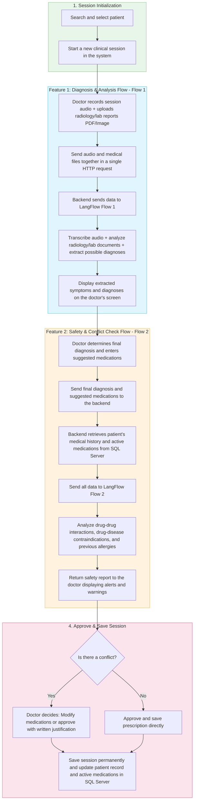

# Updated Work Plan: AI Doctor Assistant (AI Doctor Assistant)

> **Backend Implementation & Integration Plan**
>
> This document serves as the primary and updated reference for building the AI Doctor Assistant system in the **CliniKa** project. This flow has been simplified and updated based on current operational requirements to focus on **2 Main Features** and two primary touchpoints with **LangFlow** to ensure efficiency, speed, and ease of tracking.

---

## 💡 AI's Perspective on Sending "Final Diagnosis" alongside "Suggested Medications" to Flow 2

Sending the doctor's **Final Diagnosis** along with the **Suggested Medications** to the safety and conflict checking flow (Flow 2) is a **Clinical Best Practice** for the following important reasons:

1. **Checking Drug-Disease Contraindications:**
   * Safety verification is not limited to Drug-Drug Interactions; more importantly, it ensures that the new medication is safe to use with the currently diagnosed disease or the patient's existing chronic conditions.
   * *Example:* If the doctor diagnoses the patient with "Acute or Chronic Renal Failure" and prescribes a non-steroidal anti-inflammatory drug (NSAID like Voltaren), the model will immediately identify the diagnosis and trigger a high-severity warning that this drug is strictly contraindicated in this clinical condition.

2. **Verifying Medication Suitability and Indications:**
   * Sending the diagnosis to the Flow helps verify that the prescribed medication aligns with approved clinical guidelines for the diagnosed disease, thereby reducing medical errors in prescribing inappropriate dosages or clinically unsuitable medications for that specific condition.

3. **Reducing Alert Fatigue:**
   * When the AI engine understands the complete context (Diagnosis + Suggested Medications + Medical History), it delivers intelligent, clinically relevant safety alerts instead of triggering random or generic warnings that the doctor might ignore.

---

## 🗺️ System Flow Diagram

The following diagram illustrates the lifecycle of a clinical session through the two new features:



---

## 📋 Backend Development Tasks Checklist

### 1. Database Schema Validation
* [ ] Verify that the `ClinicalSessions` table supports storing temporary and final data:
  * `AudioTranscript` (transcription of the conversation).
  * `ExtractedSymptoms` (extracted symptoms as JSON).
  * `PossibleDiagnoses` (possible diagnoses suggested by Flow 1 as JSON).
  * `FinalDiagnosis` (the final diagnosis approved by the doctor).
  * `Status` (session status: `InProgress` / `Finalized`).
* [ ] Verify patient medical history tables to link them to the audit:
  * Patient's medical history and chronic diseases table: `PatientDiseases`.
  * Patient's registered allergies table: `PatientAllergies`.
  * Patient's current active medications table: `ActiveMedications`.

### 2. Data Contracts & DTOs (Data Transfer Objects)
* [ ] Create the diagnosis and analysis request object `DiagnoseSessionRequest` to receive files:
  * Contains the audio file `Audio` (of type `IFormFile`).
  * Contains a list of analysis/radiology files `Documents` (list of `IFormFile` supporting images and PDFs).
* [ ] Create the diagnosis response object `DiagnoseSessionResponse`:
  * Contains the transcription text `AudioTranscript`, extracted symptoms, and possible diagnoses as structured lists.
* [ ] Create the safety and conflict check request object `CheckSafetyRequest`:
  * Contains the doctor's final diagnosis `FinalDiagnosis`.
  * Contains the list of newly prescribed medications `PrescribedMedications`.
* [ ] Create the safety check response object `SafetyReportResponse`:
  * Contains details of drug-drug interactions (Drug Interactions).
  * Contains contraindications related to medical history and allergies (Contraindications).
  * Contains additional warnings and advice (Clinical Alerts).
* [ ] Create the final save request object `FinalizeSessionRequest`:
  * Contains the final diagnosis, list of approved prescribed medications, doctor's notes, and follow-up recommendations.

### 3. LangFlow Integration Services
* [ ] Modify `LangFlowService` to add connection to **Flow 1 (Diagnosis Flow)**:
  * Implement the `ProcessDiagnosisFlowAsync` method that accepts the audio file and attached medical files.
  * Convert files into `MultipartFormDataContent` and send them in a single request to the first flow's Endpoint in LangFlow.
  * Receive analysis output and deserialize the returned JSON (which contains the audio transcript, symptoms, document analysis, and suggested diagnoses).
* [ ] Add a method in `LangFlowService` to connect to **Flow 2 (Safety/Conflict Flow)**:
  * Implement the `CheckSafetyFlowAsync` method that accepts doctor input (final diagnosis and prescribed medications) in addition to the patient's historical data retrieved from the database.
  * Send the data as a JSON Payload to the second flow's Endpoint in LangFlow.
  * Receive the safety and conflict report and pass it to the Controller.

### 4. Controllers & Web API Endpoints
* [ ] **Endpoint 1: Receive Audio and Analysis Documents (Diagnose Session)**
  * **Route:** `POST /api/sessions/{sessionId}/diagnose`
  * **Description:** Receives the audio file and analysis/radiology documents (as `multipart/form-data`) and sends them to LangFlow Flow 1, then temporarily saves the transcript and symptoms in the session table and returns the suggested diagnoses.
* [ ] **Endpoint 2: Check Prescription and Diagnosis Safety (Check Safety)**
  * **Route:** `POST /api/sessions/{sessionId}/check-safety`
  * **Description:** Receives the entered diagnosis and suggested medications from the doctor. Retrieves the patient's medical history (diseases, allergies, active medications) from the database, sends this entire context to LangFlow Flow 2 to verify any conflicts, and returns the report to the doctor.
* [ ] **Endpoint 3: Save and Finalize Session (Finalize Session)**
  * **Route:** `POST /api/sessions/{sessionId}/finalize`
  * **Description:** Receives the final approval of the diagnosis and prescribed medications, opens a database transaction to update the session status to `Finalized`, inserts the approved medications into the patient's active records, and updates the patient's disease record in the database to ensure the medical history is consolidated for future visits.

---

## 🗃️ Data Contracts & DTOs Details

### 1. Diagnose Request
* **Request Type:** `multipart/form-data`
* **Parameters:**
  * `sessionId` (Route Parameter)
  * `audio` (Uploaded audio file - `IFormFile`)
  * `documents` (List of uploaded images or PDF files - `List<IFormFile>`)

### 2. Diagnose Session Response DTO
```csharp
public class DiagnoseSessionResponseDto
{
    public int SessionId { get; set; }
    public string AudioTranscript { get; set; }
    public List<string> ExtractedSymptoms { get; set; }
    public List<PossibleDiagnosisDto> PossibleDiagnoses { get; set; }
}

public class PossibleDiagnosisDto
{
    public string DiagnosisName { get; set; }
    public string ConfidenceScore { get; set; } // Example: "85%"
    public string Justification { get; set; }  // Medical justification for the suggestion based on symptoms or reports
}
```

### 3. Check Safety Request DTO
```csharp
public class CheckSafetyRequestDto
{
    public string FinalDiagnosis { get; set; } // The final diagnosis determined by the doctor
    public List<string> PrescribedMedications { get; set; } // The suggested medications for the prescription
}
```

### 4. Safety Report Response DTO
```csharp
public class SafetyReportResponseDto
{
    public bool HasConflict { get; set; } // Was any high-risk interaction or conflict detected?
    public List<DrugInteractionDto> DrugInteractions { get; set; } // Interactions of new medications with the patient's current medications
    public List<ContraindicationDto> Contraindications { get; set; } // Contraindications of new medications with the patient's diseases or allergies
    public List<string> ClinicalAlerts { get; set; } // Additional general safety alerts
}

public class DrugInteractionDto
{
    public string DrugA { get; set; }
    public string DrugB { get; set; }
    public string Severity { get; set; } // High / Medium / Low
    public string Description { get; set; } // Details of the interaction and clinical severity
}

public class ContraindicationDto
{
    public string MedicationName { get; set; }
    public string ConflictSource { get; set; } // Name of the chronic disease or allergy causing the conflict
    public string Severity { get; set; } // High / Medium / Low
    public string Description { get; set; }
}
```

### 5. Finalize Session Request DTO
```csharp
public class FinalizeSessionRequestDto
{
    public string FinalDiagnosis { get; set; }
    public List<PrescriptionItemDto> FinalPrescriptions { get; set; }
    public string DoctorNotes { get; set; }
}

public class PrescriptionItemDto
{
    public string DrugName { get; set; }
    public string Dosage { get; set; }    // e.g., "500mg"
    public string Frequency { get; set; } // e.g., "3 times daily"
    public int DurationDays { get; set; } // e.g., 7
}
```

---

## 🛠️ Frontend Integration Checklist (Angular)

* [ ] **File Upload and Recording Component:**
  * Provide an interface to record audio and save it as a temporary file.
  * Provide an area to upload documents (PDF or lab/radiology images).
  * Send both in a single `FormData` request to the Diagnosis endpoint upon completing the recording and upload.
* [ ] **Suggested Diagnoses Display Panel:**
  * Receive diagnosis output and display the suggested diagnoses along with confidence scores to assist the doctor in decision-making.
* [ ] **Prescription Formulation & Safety Check Trigger:**
  * When the doctor enters the final diagnosis and selects medications, a request to check conflicts is sent automatically or upon clicking the "Check Safety" button.
  * Display color-coded cards based on conflict severity (red cards for high-risk, yellow for medium-risk).
* [ ] **Save and Finalize Button:**
  * Allows the doctor to complete the session and persist data to the database after verifying medication safety or providing clinical justification if a tolerated conflict exists.
