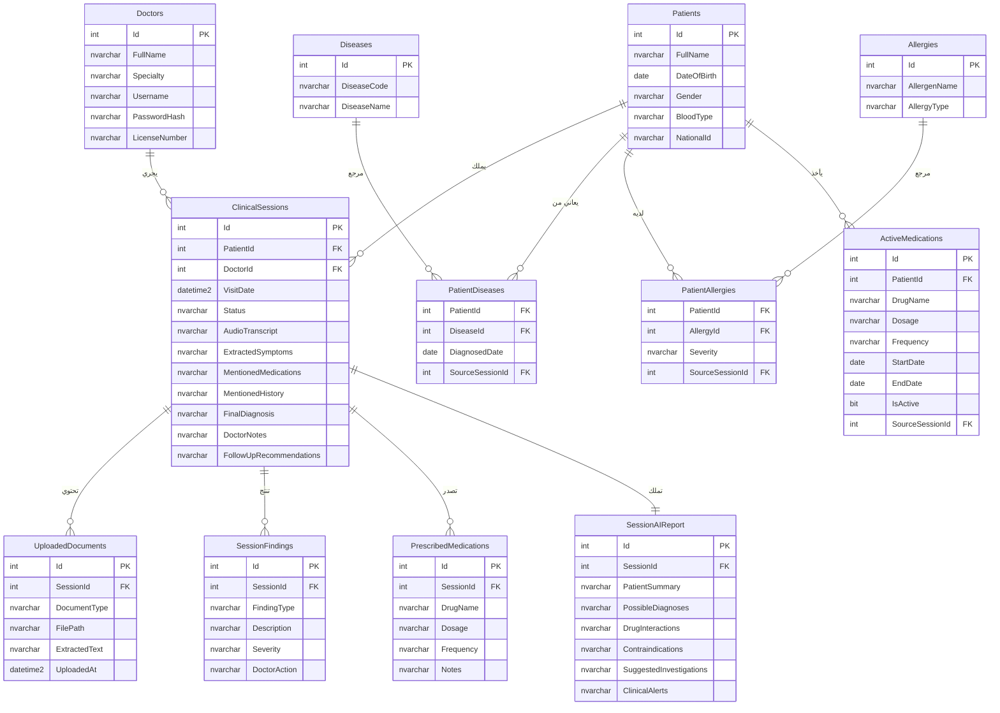

# تصميم قاعدة البيانات الكامل: AI Clinical Safety Assistant
> **مبني على الفلو الكامل بالـ 24 خطوة والـ 11 مرحلة**
> كل جدول مرتبط بالخطوة اللي بيخدمها في الفلو بالظبط.

---

## 1. مخطط العلاقات (ER Diagram)



---

## 2. ربط الجداول بخطوات الفلو

| الجدول | الخطوة في الفلو | الدور |
|:---|:---|:---|
| `Doctors` | خطوة 1 (Login) | التحقق من بيانات الطبيب وإنتاج JWT |
| `Patients` | خطوة 2 (Patient Search) | البحث واختيار المريض |
| `ClinicalSessions` | خطوة 3 (Create Visit) | إنشاء سجل الزيارة الجديدة |
| `ClinicalSessions` | خطوة 8 (STT) | حفظ الـ AudioTranscript |
| `ClinicalSessions` | خطوة 9 (Extraction) | حفظ الأعراض والأدوية المستخرجة |
| `UploadedDocuments` | خطوة 10-11 (Vision) | حفظ الملفات الطبية المرفوعة ونتائج Gemini Vision |
| `PatientDiseases` + `PatientAllergies` + `ActiveMedications` | خطوة 12 (History) | جلب التاريخ المرضي لبناء Prompt الـ RAG والـ AI |
| `SessionAIReport` | خطوة 17 (AI Report) | حفظ تقرير الذكاء الاصطناعي الكامل |
| `ClinicalSessions` | خطوة 20 (Doctor Input) | تحديث التشخيص النهائي وملاحظات الدكتور |
| `SessionFindings` | خطوة 21 (Pre-Save Check) | أرشفة التحذيرات وقرار الدكتور |
| `PrescribedMedications` | خطوة 23 (Finalize) | حفظ الوصفة الطبية المعتمدة |
| `PatientDiseases` + `ActiveMedications` | خطوة 24 (Accumulation) | تراكم التاريخ المرضي للزيارة القادمة |

---

## 3. سكريبت إنشاء الجداول (T-SQL DDL)

```sql
-- =============================================
-- AI Clinical Safety Assistant - Full DB Schema
-- SQL Server (T-SQL) - SSMS Compatible
-- =============================================

-- 1. جدول الأطباء (الخطوة 1: Login)
-- يخدم: التحقق من هوية الطبيب وإنتاج JWT Token
CREATE TABLE Doctors (
    Id              INT IDENTITY(1,1)   PRIMARY KEY,
    FullName        NVARCHAR(100)       NOT NULL,
    Specialty       NVARCHAR(100),
    Username        NVARCHAR(50)        NOT NULL UNIQUE,
    PasswordHash    NVARCHAR(255)       NOT NULL,       -- bcrypt hash, NOT plain text
    LicenseNumber   NVARCHAR(50)        NOT NULL UNIQUE,
    CreatedAt       DATETIME2           DEFAULT GETDATE()
);

-- 2. جدول المرضى (الخطوة 2: Patient Search & Select)
-- يخدم: البحث عن المريض وعرض بياناته الأساسية
CREATE TABLE Patients (
    Id              INT IDENTITY(1,1)   PRIMARY KEY,
    FullName        NVARCHAR(100)       NOT NULL,
    DateOfBirth     DATE                NOT NULL,
    Gender          NVARCHAR(10)        CHECK (Gender IN ('Male', 'Female')),
    BloodType       NVARCHAR(5),
    NationalId      NVARCHAR(20)        UNIQUE,
    Phone           NVARCHAR(20),
    CreatedAt       DATETIME2           DEFAULT GETDATE()
);

-- 3. جدول الجلسات الطبية (الخطوة 3: Create Visit)
-- يخدم: إنشاء الزيارة + حفظ النص المفرغ + حفظ الكيانات المستخرجة + قرار الدكتور النهائي
CREATE TABLE ClinicalSessions (
    Id                      INT IDENTITY(1,1)   PRIMARY KEY,
    PatientId               INT                 NOT NULL FOREIGN KEY REFERENCES Patients(Id) ON DELETE CASCADE,
    DoctorId                INT                 NOT NULL FOREIGN KEY REFERENCES Doctors(Id),
    VisitDate               DATETIME2           NOT NULL DEFAULT GETDATE(),

    -- خطوة 8: نتيجة Whisper STT
    AudioTranscript         NVARCHAR(MAX),

    -- خطوة 9: نتيجة Gemini Entity Extraction (JSON Strings)
    ExtractedSymptoms       NVARCHAR(MAX),      -- '["Cough","Fever"]'
    MentionedMedications    NVARCHAR(MAX),      -- '["Voltaren"]'
    MentionedHistory        NVARCHAR(MAX),      -- '["Kidney disease"]'

    -- خطوة 20: قرار الدكتور بعد الفحص
    FinalDiagnosis          NVARCHAR(500),
    DoctorNotes             NVARCHAR(MAX),
    FollowUpRecommendations NVARCHAR(MAX),

    -- حالة الزيارة
    Status                  NVARCHAR(20)        NOT NULL DEFAULT 'In Progress',
    -- القيم: 'In Progress' | 'Analyzed' | 'Finalized'

    FinalizedAt             DATETIME2,
    CONSTRAINT chk_symptoms_json    CHECK (ExtractedSymptoms IS NULL OR ISJSON(ExtractedSymptoms) > 0),
    CONSTRAINT chk_meds_json        CHECK (MentionedMedications IS NULL OR ISJSON(MentionedMedications) > 0)
);

-- 4. جدول تقرير الذكاء الاصطناعي (الخطوة 17: AI Safety Report)
-- يخدم: حفظ كامل تقرير الـ AI قبل أن يراجعه الدكتور
CREATE TABLE SessionAIReports (
    Id                      INT IDENTITY(1,1)   PRIMARY KEY,
    SessionId               INT                 NOT NULL UNIQUE FOREIGN KEY REFERENCES ClinicalSessions(Id) ON DELETE CASCADE,
    PatientSummary          NVARCHAR(MAX),
    PossibleDiagnoses       NVARCHAR(MAX),      -- JSON Array
    DrugInteractions        NVARCHAR(MAX),      -- JSON Array
    Contraindications       NVARCHAR(MAX),      -- JSON Array
    SuggestedInvestigations NVARCHAR(MAX),      -- JSON Array '["Chest X-Ray","CRP"]'
    ClinicalAlerts          NVARCHAR(MAX),      -- JSON Array
    GeneratedAt             DATETIME2           DEFAULT GETDATE(),
    CONSTRAINT chk_diagnoses_json CHECK (PossibleDiagnoses IS NULL OR ISJSON(PossibleDiagnoses) > 0),
    CONSTRAINT chk_alerts_json    CHECK (ClinicalAlerts IS NULL OR ISJSON(ClinicalAlerts) > 0)
);

-- 5. جدول المستندات الطبية المرفوعة (الخطوة 10-11: Vision Analysis)
-- يخدم: حفظ الأشعة والتحاليل ونتيجة تحليل Gemini Vision
CREATE TABLE UploadedDocuments (
    Id              INT IDENTITY(1,1)   PRIMARY KEY,
    SessionId       INT                 NOT NULL FOREIGN KEY REFERENCES ClinicalSessions(Id) ON DELETE CASCADE,
    DocumentType    NVARCHAR(30)        NOT NULL CHECK (DocumentType IN ('Lab PDF', 'X-Ray', 'MRI', 'CBC', 'Other')),
    FilePath        NVARCHAR(500)       NOT NULL,       -- المسار على السيرفر أو Cloud Storage
    ExtractedText   NVARCHAR(MAX),                      -- نتيجة Gemini Vision (JSON)
    UploadedAt      DATETIME2           DEFAULT GETDATE()
);

-- 6. جدول الأمراض المرجعي (ICD-10)
-- يخدم: كتالوج الأمراض يُستعلم منه عند تسجيل مرض جديد في تاريخ المريض
CREATE TABLE Diseases (
    Id              INT IDENTITY(1,1)   PRIMARY KEY,
    DiseaseCode     NVARCHAR(15)        NOT NULL UNIQUE,   -- ICD-10: N18.9, I10
    DiseaseName     NVARCHAR(150)       NOT NULL,
    Description     NVARCHAR(MAX)
);

-- 7. جدول أمراض المريض التراكمي (الخطوة 12 + الخطوة 24)
-- يخدم: قراءة التاريخ المرضي في كل زيارة، وتراكم الأمراض الجديدة بعد تأكيد الدكتور
CREATE TABLE PatientDiseases (
    PatientId       INT     NOT NULL FOREIGN KEY REFERENCES Patients(Id) ON DELETE CASCADE,
    DiseaseId       INT     NOT NULL FOREIGN KEY REFERENCES Diseases(Id) ON DELETE CASCADE,
    DiagnosedDate   DATE    NOT NULL DEFAULT CAST(GETDATE() AS DATE),
    SourceSessionId INT     FOREIGN KEY REFERENCES ClinicalSessions(Id),   -- من أي زيارة ظهر هذا المرض
    PRIMARY KEY (PatientId, DiseaseId)
);

-- 8. جدول الحساسية المرجعي
CREATE TABLE Allergies (
    Id              INT IDENTITY(1,1)   PRIMARY KEY,
    AllergenName    NVARCHAR(100)       NOT NULL,   -- 'Penicillin', 'Sulfa'
    AllergyType     NVARCHAR(50)                    -- 'Drug', 'Food', 'Environmental'
);

-- 9. جدول حساسيات المريض التراكمي (الخطوة 12 + الخطوة 24)
CREATE TABLE PatientAllergies (
    PatientId       INT             NOT NULL FOREIGN KEY REFERENCES Patients(Id) ON DELETE CASCADE,
    AllergyId       INT             NOT NULL FOREIGN KEY REFERENCES Allergies(Id) ON DELETE CASCADE,
    Severity        NVARCHAR(20)    CHECK (Severity IN ('Mild', 'Moderate', 'Severe')),
    SourceSessionId INT             FOREIGN KEY REFERENCES ClinicalSessions(Id),
    PRIMARY KEY (PatientId, AllergyId)
);

-- 10. جدول الأدوية النشطة التراكمي (الخطوة 12 + الخطوة 24)
-- يخدم: جلب الأدوية الحالية للمريض في خطوة 12 + تراكم الأدوية الجديدة في خطوة 24
CREATE TABLE ActiveMedications (
    Id              INT IDENTITY(1,1)   PRIMARY KEY,
    PatientId       INT                 NOT NULL FOREIGN KEY REFERENCES Patients(Id) ON DELETE CASCADE,
    DrugName        NVARCHAR(100)       NOT NULL,
    Dosage          NVARCHAR(50),       -- '500mg'
    Frequency       NVARCHAR(50),       -- 'Twice daily'
    StartDate       DATE                NOT NULL,
    EndDate         DATE,               -- NULL = لا يزال نشطاً
    IsActive        BIT                 NOT NULL DEFAULT 1,
    SourceSessionId INT                 FOREIGN KEY REFERENCES ClinicalSessions(Id)
);

-- 11. جدول الوصفة الطبية النهائية (الخطوة 23: Finalize)
-- يخدم: حفظ الأدوية التي وصفها الدكتور بشكل رسمي بعد التأكيد
CREATE TABLE PrescribedMedications (
    Id          INT IDENTITY(1,1)   PRIMARY KEY,
    SessionId   INT                 NOT NULL FOREIGN KEY REFERENCES ClinicalSessions(Id) ON DELETE CASCADE,
    DrugName    NVARCHAR(100)       NOT NULL,
    Dosage      NVARCHAR(50),
    Frequency   NVARCHAR(50),
    Duration    NVARCHAR(50),       -- '7 days'
    Notes       NVARCHAR(500)
);

-- 12. جدول أرشيف التنبيهات وقرارات الدكتور (الخطوة 21 + الخطوة 23)
-- يخدم: التوثيق القانوني لكل تنبيه ظهر وكيف تصرف الدكتور معه
CREATE TABLE SessionFindings (
    Id              INT IDENTITY(1,1)   PRIMARY KEY,
    SessionId       INT                 NOT NULL FOREIGN KEY REFERENCES ClinicalSessions(Id) ON DELETE CASCADE,
    FindingType     NVARCHAR(50)        NOT NULL,
    -- 'DrugContraindication' | 'DrugInteraction' | 'AllergyConflict' | 'HighRiskAlert'
    Description     NVARCHAR(MAX)       NOT NULL,
    Severity        NVARCHAR(20)        CHECK (Severity IN ('High', 'Medium', 'Low')),
    DoctorAction    NVARCHAR(50)        DEFAULT 'Pending',
    -- 'Acknowledged' | 'Overridden' | 'Rejected'
    LoggedAt        DATETIME2           DEFAULT GETDATE()
);
```

---

## 4. الفهارس (Indexes) لتسريع استعلامات الـ AI Agent

```sql
-- تسريع خطوة 2: البحث عن المريض بالاسم
CREATE INDEX idx_patients_name ON Patients(FullName);
CREATE INDEX idx_patients_national_id ON Patients(NationalId);

-- تسريع خطوة 12: جلب الأدوية النشطة فقط
CREATE INDEX idx_active_meds ON ActiveMedications(PatientId)
    WHERE IsActive = 1;

-- تسريع خطوة 12: جلب أمراض المريض
CREATE INDEX idx_patient_diseases ON PatientDiseases(PatientId);

-- تسريع خطوة 12: جلب حساسيات المريض
CREATE INDEX idx_patient_allergies ON PatientAllergies(PatientId);

-- تسريع جلب زيارات المريض بالترتيب الزمني
CREATE INDEX idx_sessions_patient_date ON ClinicalSessions(PatientId, VisitDate DESC);

-- تسريع جلب التنبيهات لجلسة معينة
CREATE INDEX idx_findings_session ON SessionFindings(SessionId);

-- تسريع جلب الوصفات لجلسة معينة
CREATE INDEX idx_prescribed_session ON PrescribedMedications(SessionId);
```

---

## 5. بيانات اختبار تجريبية (Seed Data)

تُغذي قاعدة البيانات بمريض وهمي لاختبار سيناريو التعارض الكامل:

```sql
-- طبيب تجريبي
INSERT INTO Doctors (FullName, Specialty, Username, PasswordHash, LicenseNumber)
VALUES (N'Dr. Khaled Hassan', N'Internal Medicine', 'dr_khaled',
        '$2a$11$HASHEDPASSWORD...', 'LIC-2024-001');

-- مريض تجريبي
INSERT INTO Patients (FullName, DateOfBirth, Gender, BloodType, NationalId)
VALUES (N'Ahmad Al-Otaibi', '1974-05-12', 'Male', 'O+', '1234567890');

-- أمراض مرجعية
INSERT INTO Diseases (DiseaseCode, DiseaseName) VALUES
('N18.9', 'Chronic Kidney Disease'),
('I10',   'Essential Hypertension'),
('J18.9', 'Bacterial Pneumonia');

-- ربط المريض (Id=1) بالفشل الكلوي والضغط
INSERT INTO PatientDiseases (PatientId, DiseaseId, DiagnosedDate) VALUES
(1, 1, '2022-03-10'),
(1, 2, '2020-07-15');

-- حساسيات مرجعية
INSERT INTO Allergies (AllergenName, AllergyType) VALUES
('Penicillin', 'Drug'),
('NSAIDs',     'Drug');

-- ربط المريض بحساسية البنسلين
INSERT INTO PatientAllergies (PatientId, AllergyId, Severity) VALUES
(1, 1, 'Severe');

-- الأدوية الحالية للمريض
INSERT INTO ActiveMedications (PatientId, DrugName, Dosage, Frequency, StartDate, IsActive)
VALUES (1, 'Aspirin', '81mg', 'Once daily', '2023-01-01', 1);
```

---

## 6. سيناريو الاختبار الكامل على هذه البيانات

> **السيناريو**: المريض (أحمد) يجيء بكحة وحرارة. الطبيب يقرر يصرفه Voltaren وAmoxicillin.

| الخطوة | ما يحصل في قاعدة البيانات |
|:---|:---|
| خطوة 3 | `ClinicalSessions` → سجل جديد: `VisitId=300, Status='In Progress'` |
| خطوة 8 | `ClinicalSessions` → تحديث `AudioTranscript` بالنص المفرغ |
| خطوة 9 | `ClinicalSessions` → تحديث `ExtractedSymptoms` و`MentionedMedications` |
| خطوة 10-11 | `UploadedDocuments` → سجل جديد بملف التحليل ونتيجة Gemini Vision |
| خطوة 12 | **قراءة** من `PatientDiseases` + `PatientAllergies` + `ActiveMedications` |
| خطوة 17 | `SessionAIReports` → سجل جديد بالتشخيصات المقترحة وتحذير Voltaren الأحمر |
| خطوة 21 | `SessionFindings` → سجل التحذير: `FindingType='DrugContraindication', Severity='High'` |
| خطوة 23 | `ClinicalSessions` → تحديث `FinalDiagnosis='Bacterial Pneumonia', Status='Finalized'` |
| خطوة 23 | `PrescribedMedications` → سجلان: Azithromycin + Paracetamol (بدلاً من Voltaren) |
| خطوة 24 | `PatientDiseases` → سجل جديد: Bacterial Pneumonia مع `SourceSessionId=300` |
| خطوة 24 | `ActiveMedications` → سجل جديد: Azithromycin مع `SourceSessionId=300` |
