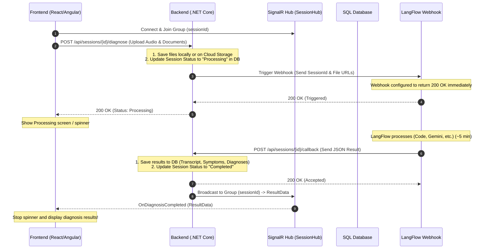

# دليل بنية المعالجة غير المتزامنة وتكامل SignalR للجلسات الطبية (Asynchronous Diagnosis Workflow Guide)

يوضح هذا المستند كيفية حل مشكلة الـ **Timeout (5 دقائق)** الناتجة عن طول فترة معالجة الذكاء الاصطناعي في LangFlow، وذلك عن طريق الانتقال إلى البنية غير المتزامنة (Asynchronous Request-Reply Pattern) واستخدام **SignalR** لتحديث الواجهة الأمامية (Frontend) بشكل فوري ولحظي عند انتهاء التحليل.

---

## 1. مخطط تدفق البيانات (Architecture Diagram)

يوضح المخطط التالي دورة حياة الطلب بالكامل من البداية وحتى عرض النتيجة:



---

## 2. خطوات التطبيق (Implementation Steps)

### الخطوة 1: إعداد الـ SignalR Hub بالـ Backend
نقوم بإنشاء Hub يتيح للـ Frontend الانضمام لغرفة (Group) خاصة بالجلسة الحالية لتلقي الإشعارات الخاصة بها فقط.

**ملف جديد: `CliniKa.Presentation/Hubs/SessionHub.cs`**
```csharp
using Microsoft.AspNetCore.SignalR;
using System.Threading.Tasks;

namespace CliniKa.Presentation.Hubs
{
    public class SessionHub : Hub
    {
        // يتيح للـ Frontend الانضمام لمجموعة الجلسة لتلقي تحديثات هذه الجلسة فقط
        public async Task JoinSessionGroup(int sessionId)
        {
            await Groups.AddToGroupAsync(Context.ConnectionId, $"Session_{sessionId}");
        }

        // يتيح للـ Frontend مغادرة المجموعة عند انتهاء الحاجة إليها
        public async Task LeaveSessionGroup(int sessionId)
        {
            await Groups.RemoveFromGroupAsync(Context.ConnectionId, $"Session_{sessionId}");
        }
    }
}
```

ثم يجب تسجيل SignalR و الـ Hub في ملف `Program.cs` أو `PresentationServiceExtensions.cs`:
```csharp
// في تسجيل الخدمات:
services.AddSignalR();

// في الـ Middleware Pipeline:
app.MapHub<SessionHub>("/hubs/session");
```

---

### الخطوة 2: تحديث الجلسة وحفظ الملفات في الـ Service
بدلاً من استدعاء الـ LangFlow والانتظار سيعمل السيرفر كـ **Fire-and-Forget**:
1. يقوم بحفظ الملفات الصوتية والمستندات محلياً أو على السيرفر لتوليد روابط مباشرة لها (URLs).
2. يرسل روابط الملفات ومعرّف الجلسة (`SessionId`) إلى LangFlow Webhook.
3. يقوم بتغيير حالة الجلسة في قاعدة البيانات إلى `"Processing"`.
4. يستجيب مباشرة للـ Frontend بـ `200 OK`.

**تعديل في الـ `SessionService.cs`:**
```csharp
public async Task<GeneralResult<string>> InitiateDiagnosisAsync(int sessionId, IFormFile audioFile, List<IFormFile>? documents)
{
    var session = await _unitOfWork.ClinicalSessions.GetAsync(s => s.Id == sessionId, trackChanges: true);
    if (session == null) return GeneralResult<string>.NotFound("Session not found.");

    // 1. رفع الملفات وتوليد الروابط
    var audioUrl = await _fileService.SaveAudioAsync(audioFile);
    var docUrls = await UploadAndGetUrlsAsync(documents);

    // 2. تحديث حالة الجلسة إلى قيد المعالجة
    session.Status = "Processing";
    await _unitOfWork.SaveChangesAsync();

    // 3. استدعاء فلو الـ LangFlow بشكل غير متزامن (دون انتظار الرد الكامل)
    // نرسل الـ SessionId والروابط فقط
    _ = _langFlowService.TriggerAsyncFlow(sessionId, audioUrl, docUrls); 

    return GeneralResult<string>.Success("Processing started", "Diagnosis has been queued for processing.");
}
```

---

### الخطوة 3: إنشاء الـ Callback Endpoint بالـ Controller
هذا الـ Endpoint هو الذي سيقوم الفلو (LangFlow) بطلبه عند انتهاء معالجة البيانات لإرسال النتائج.

**إضافة إلى الـ `SessionsController.cs`:**
```csharp
using Microsoft.AspNetCore.SignalR;
using CliniKa.Presentation.Hubs;

// في الـ Constructor نقوم بحقن IHubContext
private readonly IHubContext<SessionHub> _hubContext;

[HttpPost("{id:int}/callback")]
public async Task<IActionResult> DiagnosisCallback(
    [FromRoute] int id, 
    [FromBody] LangFlowDiagnosisResult result)
{
    // 1. التحقق من وجود الجلسة وتحديث البيانات في قاعدة البيانات
    var session = await _unitOfWork.ClinicalSessions.GetAsync(s => s.Id == id, trackChanges: true);
    if (session == null) return NotFound();

    session.AudioTranscript = result.AudioTranscript;
    session.ExtractedSymptoms = JsonSerializer.Serialize(result.Symptoms);
    session.Status = "Completed";
    
    // تحديث التقرير الطبي
    UpdateAiReport(session, result.PossibleDiagnoses);
    await _unitOfWork.SaveChangesAsync();

    // 2. إرسال النتيجة فوراً للفرونت إند المتصل عبر SignalR
    var responseDto = MapToResponseDto(id, result);
    await _hubContext.Clients.Group($"Session_{id}").SendAsync("OnDiagnosisCompleted", responseDto);

    return Ok(GeneralResult.Success("Callback processed and Frontend notified."));
}
```

---

### الخطوة 4: تهيئة الفلو (LangFlow / Activepieces)
لتجنب الـ Timeout، يجب التأكد من الخطوات التالية داخل أداة بناء الفلو:
1. **Webhook Trigger Settings:**
   * تأكد من ضبط إعدادات الـ Webhook لتستجيب بـ `200 OK` مباشرة بمجرد استقبال الـ Payload الأولي من الـ Backend (أو ما يسمى **Return Response / Ack** في بداية الخطوات).
2. **خطوة الإرسال (Send HTTP Request):**
   * بعد انتهاء خطوة Gemini، أضف خطوة إرسال طلب HTTP من نوع `POST` إلى السيرفر الخاص بك على الرابط التالي:
     `https://your-api-domain.com/api/sessions/{{sessionId}}/callback`
   * ضع البيانات المستخرجة في الـ Body كـ JSON متطابق مع الـ DTO المتوقع بالـ Backend.
   * **للأمان:** أضف Header مخصص مثل `X-Callback-Secret` وتأكد من التحقق منه في الـ Controller لتفادي استقبال بيانات عشوائية من أي مصدر غير موثوق.

---

### الخطوة 5: ربط الـ Frontend بالـ SignalR (Client Integration)
يوضح الكود التالي (بصيغة JavaScript/TypeScript) كيف يستمع الفرونت إند للتحديثات:

```javascript
import * as signalR from "@microsoft/signalr";

const sessionId = 123; // رقم الجلسة الحالية

// 1. إنشاء الاتصال مع الـ Hub بالـ Backend
const connection = new signalR.HubConnectionBuilder()
    .withUrl("https://your-api-domain.com/hubs/session")
    .withAutomaticReconnect()
    .build();

async function startConnection() {
    try {
        await connection.start();
        console.log("SignalR Connected.");
        
        // 2. الانضمام إلى مجموعة هذه الجلسة بالتحديد
        await connection.invoke("JoinSessionGroup", sessionId);
    } catch (err) {
        console.error("SignalR Connection Error: ", err);
        setTimeout(startConnection, 5000);
    }
}

// 3. الاستماع لحدث اكتمال التحليل
connection.on("OnDiagnosisCompleted", (resultData) => {
    console.log("Diagnosis Completed!", resultData);
    
    // إخفاء الـ Spinner وعرض البيانات للمستخدم
    displayResults(resultData);
    
    // مغادرة المجموعة لإنهاء الاتصال بهذه الجلسة
    connection.invoke("LeaveSessionGroup", sessionId);
});

// بدء الاتصال
startConnection();
```

---

## 3. المميزات الرئيسية لهذا الحل (Core Advantages)

* **ثبات وموثوقية عالية (Stability):** لن يواجه الـ Backend أو الـ Frontend أي خطأ Timeout بسبب طول وقت المعالجة.
* **تحديث فوري (Real-time):** بمجرد انتهاء الفلو، تظهر النتيجة للمستخدم فوراً دون الحاجة لطلبها يدوياً أو عمل Refresh للشاشة.
* **تخفيف العبء على السيرفر (Low Overhead):** لا يوجد Polling دوري يستهلك الـ Network bandwidth ويعيد الاستعلام من قاعدة البيانات بشكل متكرر دون فائدة.
* **مرونة تجربة المستخدم (Better UX):** يمكن للطبيب الخروج من صفحة الفحص أو إغلاق المتصفح تماماً، وسيقوم النظام بحفظ النتيجة في قاعدة البيانات بمجرد وصولها ليعرضها للطبيب لاحقاً عند فتح الجلسة مرة أخرى.
<!-- ===========
 -->

 نعم، بالضبط 100%! فهمك وتلخيصك للموضوع دقيق جداً وعملي:

قناة اتصال SignalR:

بمجرد دخول الطبيب لصفحة الفحص أو رفع الملفات، ينضم الـ Frontend لقناة (Room/Group) خاصة بـ sessionId.
الطبيب يمكنه الانتظار أو تصفح أي صفحة أخرى.
بمجرد وصول النتيجة من الفلو وتحديثها في قاعدة البيانات، يقوم السيرفر بـ "دفع" (Push) النتيجة فوراً لتلك الصفحة لتُعرض مباشرة.
تمرير الروابط (URLs) بدلاً من الملفات الخام (File Streams):

هذا هو التحسين الأهم للأداء (Performance Optimization).
إرسال ملفات صوتية كبيرة الحجم عبر الـ HTTP Webhook مباشرة للفلو غالباً ما يفشل بسبب قيود حجم البيانات (Request Payload Limits) في أدوات الفلو أو بسبب بطء الرفع المزدوج (من الـ Frontend للـ Backend ثم من الـ Backend للفلو).
الحل الأفضل كما ذكرت: الـ Backend يرفعها أولاً على سيرفرك أو أي Cloud Storage ويحصل على روابط مباشرة وسريعة، ثم يرسل فقط الـ URLs للفلو في ثانية واحدة، والفلو يقرأها هناك براحته أثناء المعالجة.