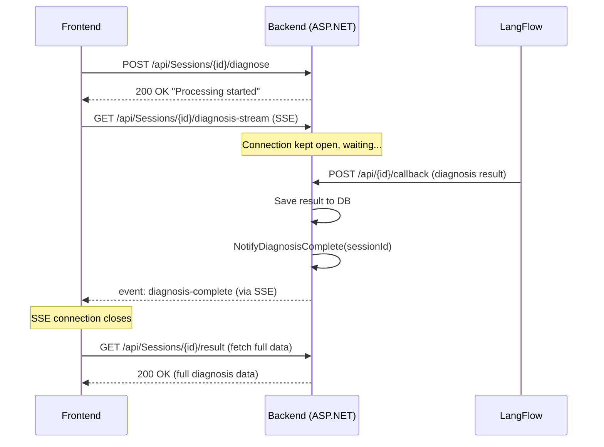

# Server-Sent Events (SSE) for Diagnosis Callback Notification

## Background

Currently, when LangFlow finishes processing a diagnosis, it calls `DiagnosisCallback` on the backend. The frontend has **no way to know** when this happens — it would need to poll repeatedly. We'll implement **Server-Sent Events (SSE)** so the backend can push a real-time notification to the frontend the instant the callback arrives.

### Why SSE over SignalR/WebSockets?

| Feature | SSE | WebSocket / SignalR |
|---|---|---|
| Direction | Server → Client (one-way) | Bidirectional |
| Protocol | Plain HTTP | Upgraded TCP connection |
| Complexity | Very low — just an HTTP endpoint | Needs hub, negotiation, fallback |
| Browser support | All modern browsers | All modern browsers |
| Best for | Notifications, status updates | Chat, real-time collaboration |

Since we only need **server → client** push (to say "callback arrived"), SSE is the simplest, most lightweight choice.

## Proposed Changes

### 1. Application Layer — New Interface

#### [NEW] [IDiagnosisNotificationService.cs](file:///d:/Graduation-Pro/CliniKa/CliniKa.Application/Abstractions/Services/IDiagnosisNotificationService.cs)

A simple contract with two methods:
- `WaitForNotificationAsync(int sessionId, CancellationToken ct)` — blocks until a notification arrives for this session
- `NotifyDiagnosisComplete(int sessionId)` — signals that the callback for this session has been received

Uses `System.Threading.Channels` internally for thread-safe, async producer-consumer pattern.

---

### 2. Infrastructure Layer — Implementation

#### [NEW] [SseNotificationService.cs](file:///d:/Graduation-Pro/CliniKa/CliniKa.Infrastructure/Services/SseNotificationService.cs)

Implementation details:
- Uses `ConcurrentDictionary<int, Channel<bool>>` to store one channel per session
- `WaitForNotificationAsync` creates/gets a channel for the session, then awaits `ReadAsync`
- `NotifyDiagnosisComplete` writes to the channel, signaling all waiting clients
- Channels are automatically cleaned up after notification is sent
- **Registered as Singleton** (must survive across HTTP requests)

---

### 3. Infrastructure Layer — DI Registration

#### [MODIFY] [InfrastructureExtensions.cs](file:///d:/Graduation-Pro/CliniKa/CliniKa.Infrastructure/Extensions/InfrastructureExtensions.cs)

Add the singleton registration:
```csharp
services.AddSingleton<IDiagnosisNotificationService, SseNotificationService>();
```

---

### 4. Presentation Layer — New SSE Endpoint + Callback Integration

#### [MODIFY] [SessionsController.cs](file:///d:/Graduation-Pro/CliniKa/CliniKa.Presentation/Controllers/SessionsController.cs)

Two changes:

**A. Inject `IDiagnosisNotificationService`** into the controller constructor.

**B. Add new SSE endpoint:**
```
GET /api/Sessions/{sessionId}/diagnosis-stream
```
This endpoint:
1. Sets `Content-Type: text/event-stream` + `Cache-Control: no-cache`
2. Sends an initial `event: connected` message
3. Awaits `WaitForNotificationAsync(sessionId)`
4. When callback arrives, sends `event: diagnosis-complete` with the sessionId as data
5. Connection closes automatically — **the frontend then makes a normal GET request to fetch the full data**

**C. Call `NotifyDiagnosisComplete`** at the end of `DiagnosisCallback` (after saving succeeds).

---

### 5. Presentation Layer — CORS Update

#### [MODIFY] [Program.cs](file:///d:/Graduation-Pro/CliniKa/CliniKa.Presentation/Program.cs)

No changes needed — the existing `AllowAll` CORS policy already permits SSE connections since SSE uses standard HTTP GET requests.

---

## Architecture Flow



## Verification Plan

### Manual Verification
1. Start the backend server
2. Open two terminal windows:
   - **Terminal 1**: `curl -N http://localhost:PORT/api/Sessions/1/diagnosis-stream` (SSE listener)
   - **Terminal 2**: Send a POST to the callback endpoint to simulate LangFlow
3. Verify Terminal 1 receives the `diagnosis-complete` event
4. Verify the SSE connection closes cleanly after the event

### Code Review
- Ensure the `SseNotificationService` is Singleton (required since it must persist across requests)
- Ensure channels are cleaned up to prevent memory leaks
- Ensure `CancellationToken` is respected for client disconnection
